# OverFixed! 기술 문서

> 우주 화물선의 정비원이 되어 선외로 흘러가는 재료를 모아 주문을 채우고, 사고를 수습하며 항해를 버티는 **1인칭 3D 아케이드**
>
> Unity 6 · C# · 1인 개인 프로젝트 · 2026.10.21 ~ 2026.11.04

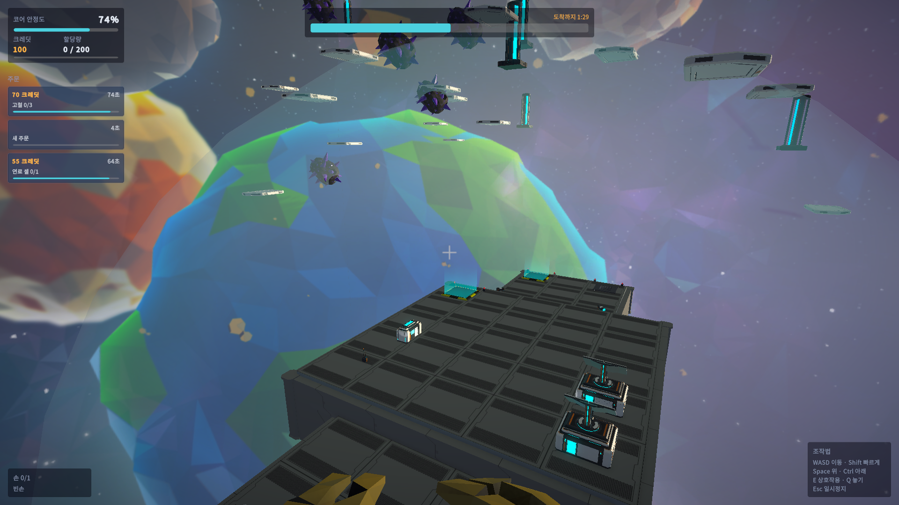

**한눈에 보기**

- **무엇을**: 선외 재료 수집 → 주문 납품 → 할당량·안정도 관리 → 도착·정비로 이어지는 항해 한 판
- **핵심 설계**: 수치는 데이터(TSV·ScriptableObject·JSON)에 · 값의 주인은 `GameManager` 하나 · 재료 90개 풀 재사용 · 미니게임 3종 공통 틀
- **결과**: 11/2 시연까지 한 판 전체 흐름 완성 · 시연 뒤 밸런스 조정 3건을 코드 수정 0줄로 처리

## 목차

1. [프로젝트 개요](#1-프로젝트-개요)
2. [시스템 구조](#2-시스템-구조)
3. [데이터 주도 설계](#3-데이터-주도-설계)
4. [게임 루프와 씬 간 상태](#4-게임-루프와-씬-간-상태)
5. [재료 흐름과 오브젝트 풀링](#5-재료-흐름과-오브젝트-풀링)
6. [사고와 미니게임](#6-사고와-미니게임)
7. [기타 구현](#7-기타-구현)
8. [결과 및 배운 점](#8-결과-및-배운-점)

---

## 1. 프로젝트 개요

### 1.1 무엇을 만들었나 (What)

**OverFixed!** 는 화물선이 목적지에 도착하기까지 한 번의 항해(3~6분)를 버티는 1인칭 3D 아케이드입니다.

플레이어는 에어락을 지나 선외로 나가 우주를 흘러가는 재료를 잡고, 선내 터미널에 제출해 주문을 채웁니다. 주문 보상으로 받은 크레딧은 도착 전까지 내야 하는 **할당량**과, 매초 줄어드는 **코어 안정도**를 회복하는 데 나눠 씁니다. 그사이 함선 패널에 사고가 나면 제한시간 안에 미니게임으로 수습해야 합니다.

- 할당량을 다 낸 채 도착 → 정산 → 정비 → 다음 항해 (할당량·항해 시간 증가)
- 안정도 0%, 또는 할당량을 다 내지 못한 채 도착 → 게임오버, 최고 기록 저장

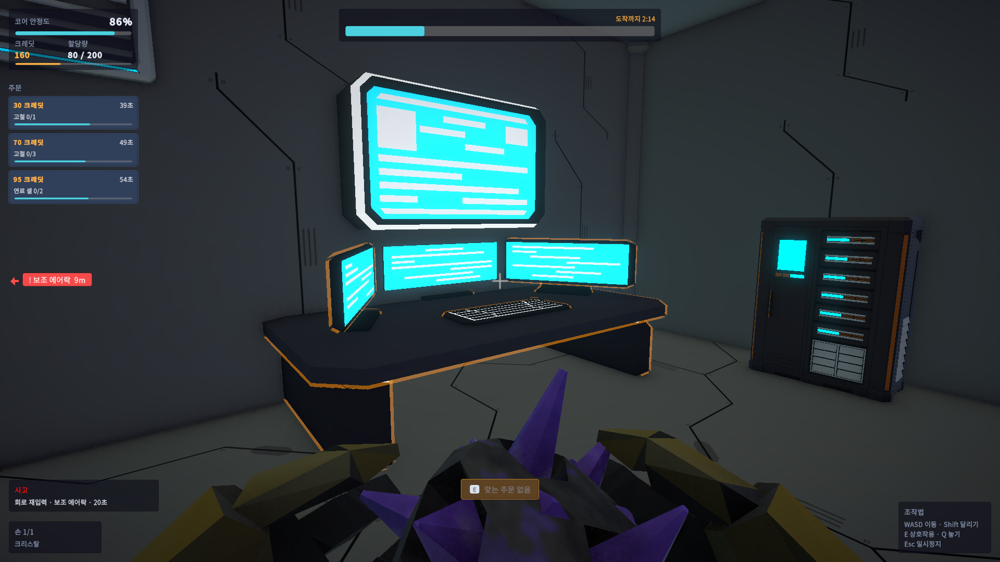

*항해 중 화면. 왼쪽 위는 코어 안정도·크레딧·할당량, 그 아래는 마감이 다른 주문 3칸, 위쪽 막대는 도착까지 남은 시간입니다. 왼쪽 아래 사고 알림과 화면 가장자리의 빨간 화살표가 사고 난 패널의 위치를, 가운데 아래 안내가 지금 E로 할 수 있는 일을 알려 줍니다.*

이 문서는 게임을 이루는 시스템 중 아래 **네 가지**의 설계·구현과 선택의 이유를 다룹니다.

| 핵심 기능 | 한 줄 요약 | 장 |
|---|---|---|
| 데이터 주도 설계 | 밸런스 표는 TSV, 조절값은 ScriptableObject, 기록은 JSON. 수치는 코드 밖에서 바꾼다 | 3 |
| 게임 루프와 씬 간 상태 | 3개 씬을 오가는 값과 규칙을 `GameManager` 하나에 모으고, 결과는 이벤트로 알린다 | 4 |
| 재료 흐름과 오브젝트 풀링 | 재료 90개를 재사용하고, 모든 재료가 함선 지붕 위를 스치도록 경로를 계산한다 | 5 |
| 사고와 미니게임 | 조작이 다른 미니게임 3종이 하나의 규칙(제한시간·누적 성공·닫았다 다시 열기)을 공유한다 | 6 |

### 1.2 왜 이렇게 만들었나 (Why)

**모든 것이 동시에 급할 때, 무엇부터 할지 고르는 재미를 만들고자 했습니다.**

이 게임의 재미는 **여러 시간 압박이 한꺼번에 겹치는 데** 있습니다. 재료는 약 30초 뒤 사라지고, 주문 3개는 각자 마감(60~90초)이 다가오고, 사고는 30~60초마다 터지며, 안정도는 매초 줄어듭니다. 이 구조를 약 2주 안에 만들면서 부딪힌 문제는 네 가지였습니다.

| 문제 | 구체적 상황 | 해결 방향 |
|---|---|---|
| 수치가 계속 바뀐다 | 밸런스 표의 값만 약 100개(항해 10단계 × 6개 값, 주문 9종, 사고 3종 등). 실제로 시연 뒤에도 재료 생성 비중과 난이도 표를 다시 조정했다 | 수치를 코드 밖 데이터로 (3장) |
| 값이 씬을 넘어 이어져야 한다 | 크레딧·안정도·항해 번호가 타이틀 → 항해 → 정비 3개 씬을 오가고, 8개 클래스가 이 값을 바꾸거나 씬을 넘긴다 | 값의 주인을 하나로 (4장) |
| 재료가 끊임없이 생기고 사라진다 | 초당 1.5개가 생겨 약 30초 흐른 뒤 사라진다. 평균 45개가 동시에 떠 있고, 항해 1회에 270~540개 | 만들어 둔 것을 재사용 (5장) |
| 규칙은 같고 조작은 다르다 | 미니게임 3종은 입력 방식이 모두 다르지만 30초 제한, 누적 3회 성공, 시간 초과 시 안정도 −10%, 닫아도 진행 유지는 같다 | 공통 틀 + 종류별 구현 (6장) |

목표는 **11월 2일 시연까지 한 판(타이틀 → 항해 → 정산 → 정비 → 다음 항해, 게임오버·기록)이 끝까지 도는 버전을 만들되, 이후의 수치 조정과 기능 추가가 쉬운 구조로 만드는 것**이었습니다.

### 1.3 개발 환경

| 항목 | 내용 |
|---|---|
| 엔진 | Unity 6 (6000.3.15f1), URP |
| 언어 | C# |
| 주요 패키지 | Input System, uGUI + TextMeshPro, DOTween |
| 공용 유틸리티 | `SingletonBase<T>`, `SimpleInput`(Input System 래퍼): 강의 저장소에 포함된 코드 |
| 외부 에셋 | 함선 내부·소품, 플레이어 로봇(Robobot T7), 우주 스카이박스 |
| 도구 | JetBrains Rider, Git / GitHub |
| 기간 | 2026.10.21 ~ 2026.11.04 (11.02 시연) |
| 인원 | 1인 |
| 규모 | C# 스크립트 53개(약 3,400줄), 씬 3개, 밸런스 표(TSV) 4종, 설정 ScriptableObject 7종 |

### 1.4 링크

- GitHub: https://github.com/rlawlsdn77/Unity-3D-OverFixed
- 시연 영상: (추가 예정)

### 1.5 핵심 루프

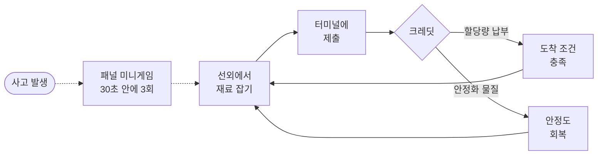

항해 중에는 "같은 크레딧을 할당량과 안정도 중 어디에 쓸지", "사고가 나면 하던 일을 멈출지"를 계속 고르게 됩니다. 항해가 끝나면 [2.1](#21-씬-구성과-흐름)의 씬 흐름을 따라 다음 항해로 이어집니다.

### 1.6 조작법

| 상황 | 입력 | 동작 |
|---|---|---|
| 선내 | WASD · Shift | 이동 (3 m/s) · 달리기 (6 m/s) |
| 선외 | WASD · Space · Ctrl | 관성 유영 (최고 5 m/s) · 상승 · 하강 |
| 선외 | Shift | 제트 추진 (최고 10 m/s) |
| 공통 | 마우스 | 시점 (1인칭) |
| 공통 | E | 상호작용: 재료 줍기 · 터미널 제출/열기 · 사고 패널 · 에어락 |
| 공통 | Q | 든 재료 놓기 |
| 공통 | Esc | 열린 화면 닫기, 없으면 일시정지 |
| 미니게임 | Space / 방향키·WASD / 마우스 왼쪽 클릭 | 타이밍 바 / 순서 입력 / 전선 잇기 |
| 미니게임 | Q | 화면 닫기 (사고와 진행은 유지) |

### 1.7 레퍼런스

| 게임 | 참고한 점 | 이 프로젝트에서 다른 점 |
|---|---|---|
| Overcooked! | 한 번에 하나만 들고 옮기는 운반, 마감이 다른 주문 여러 개를 동시에 처리하는 분주함 | 재료가 무중력 선외에서 흘러가다 사라지고, 에어락을 지나 직접 나가서 잡아야 한다. 제출한 재료는 그 재료가 필요한 주문 중 가장 급한 주문에 자동으로 들어간다 |
| Lethal Company | 정해진 할당량을 채워야 하는 압박, 도착·정산 뒤 다시 출발하는 반복 | 할당량을 항해 중 터미널에서 크레딧으로 나눠 내고, 같은 크레딧을 코어 안정도 회복에도 써야 해 배분을 고민한다. 실패 조건이 둘(안정도 0%, 미납 도착)이다 |

---

## 2. 시스템 구조

### 2.1 씬 구성과 흐름

| 씬 | 역할 | 주요 화면 |
|---|---|---|
| MainMenu | 타이틀, 최고 기록 표시 | `TitleUI` |
| SPACE | 항해 (선내·선외, 주문, 사고) | `HudUI`, `TerminalUI`, `MiniGameUI`, `PauseUI`, `SettlementUI`, `GameOverUI` |
| PLANET | 정비 (안정화 물질 구매, 다음 항해 시작) | `MaintenanceUI` |

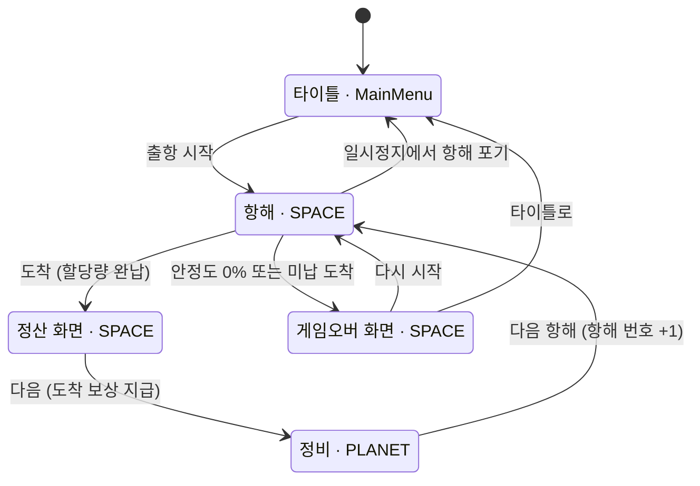

| 정산 | 정비 | 게임오버 |
|---|---|---|
| 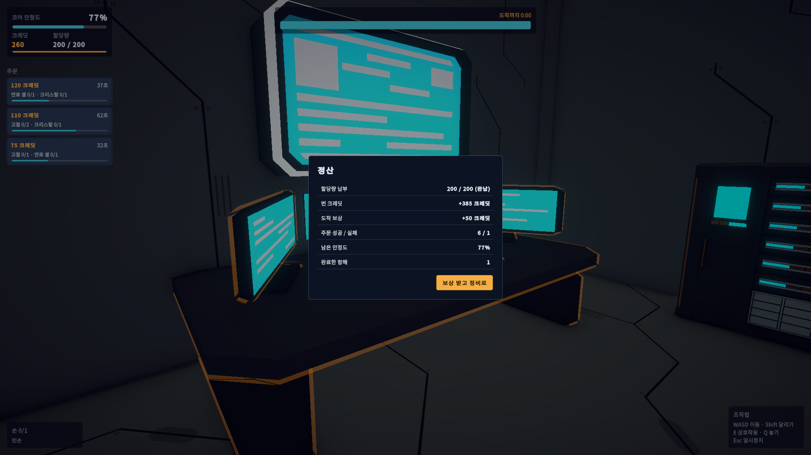 | 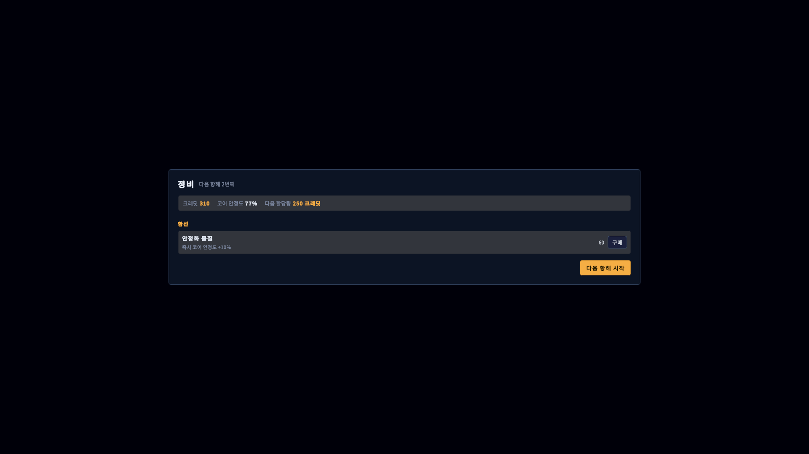 | 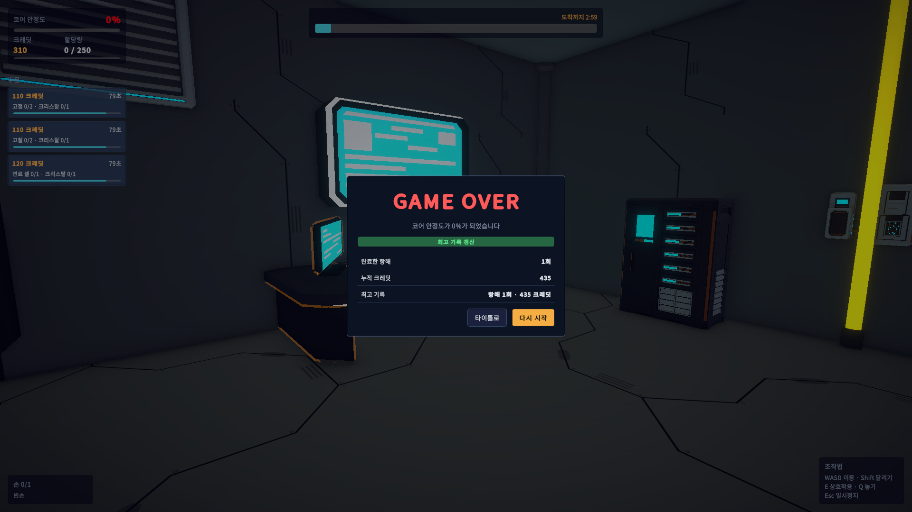 |

*항해가 끝나는 두 갈래. 할당량을 다 내고 도착하면 정산을 거쳐 정비 씬으로 넘어가고, 안정도가 0%가 되면 게임오버 화면에 완료한 항해 수와 최고 기록이 뜹니다. 세 화면의 값은 모두 씬을 넘어 살아 있는 `GameManager` 하나에서 읽습니다.*

### 2.2 아키텍처

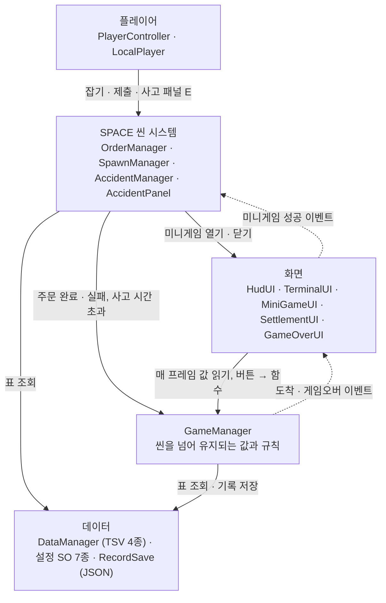

> 실선은 직접 호출, 점선은 이벤트(구독한 쪽이 받음)입니다. 설정 SO는 각 컴포넌트가 인스펙터로 직접 참조합니다. 클래스 단위의 흐름은 4.1, 6.1, 6.3의 다이어그램에서 다룹니다.

### 2.3 설계 규칙

구조 전체를 관통하는 규칙은 네 가지입니다. 각 장의 '고민과 선택'에서 이 규칙을 왜 정했는지 설명합니다.

1. **값은 `GameManager`에만 둔다.** 크레딧·안정도·할당량·항해 번호는 `{ get; private set; }`이고, 바꾸는 길은 `GameManager`의 함수뿐입니다. → [4장](#4-게임-루프와-씬-간-상태)
2. **밸런스 수치는 데이터에만 둔다.** 행이 여러 개인 표는 TSV, 한 벌뿐인 조절값은 ScriptableObject에 두고, 같은 값을 두 곳에 두지 않습니다. → [3장](#3-데이터-주도-설계)
3. **계속 변하는 값은 읽고, 한 번 일어나는 일은 이벤트로 알린다.** HUD는 매 프레임 값을 읽고, 도착·게임오버·미니게임 성공은 이벤트로 알립니다. → [4.4](#44-고민과-선택)
4. **상태와 화면을 나눈다.** 사고의 남은 시간·성공 횟수는 화면이 아니라 사고가 난 패널이 갖습니다. 화면을 닫아도 상태는 남습니다. → [6장](#6-사고와-미니게임)

### 2.4 핵심 클래스 역할

| 계층 | 클래스 | 책임 | 하지 않는 일 |
|---|---|---|---|
| 데이터 | `TsvParser` | TSV 문자열 → 행 객체 목록 | 파일을 찾거나 캐시하지 않음 |
| 데이터 | `DataManager` | 표를 처음 조회할 때 읽어 캐시, ID·번호로 행 조회 | 값을 바꾸지 않음 |
| 데이터 | `RecordSave` | 최고 기록 JSON 읽기·갱신 | |
| 상태 | `GameManager` | 크레딧·안정도·할당량·항해 번호와 그 규칙, 항해 진행, 씬 전환 | 화면을 직접 그리지 않음 |
| 규칙 | `OrderBoard` | 주문 3칸 규칙 (배정·완료·실패·재충전) | Unity에 의존하지 않음 (순수 C# 클래스) |
| 시스템 | `OrderManager` | 항해 중 `OrderBoard`의 시간을 넘기고 결과를 `GameManager`에 전달 | |
| 시스템 | `SpawnManager` | 재료 풀, 생성 주기, 흐름 경로 | |
| 시스템 | `AccidentManager` | 사고 간격과 패널 선택 (한 번에 하나) | 사고 진행·판정 |
| 시스템 | `AccidentPanel` | 사고 하나의 상태(종류·남은 시간·성공 횟수)와 해결·실패 판정 | 화면·입력 |
| 플레이어 | `PlayerController` | 입력, 선내·선외 이동, 시점, 조작 잠금 | 대상별 행동 |
| 플레이어 | `LocalPlayer` | E·Q 행동 (줍기·제출·패널·에어락·놓기) | 입력 읽기 |
| 화면 | `HudUI`, `TerminalUI` | 값을 읽어 표시, 버튼 입력을 `GameManager` 함수로 전달 | 게임 값 계산 |
| 화면 | `MiniGameUI` | 미니게임 화면 열기·닫기, 사고 종류에 맞는 미니게임 선택 | 성공·실패 판정 |
| 화면 | `MiniGame` (3종) | 종류별 입력과 성공 1회 판정 | 누적 횟수·제한시간 판정 |

---

## 3. 데이터 주도 설계

### 3.1 문제와 구조

**문제.** 밸런스 값은 플레이해 보며 계속 바뀝니다. 이 값이 스크립트 곳곳에 상수로 흩어져 있으면 ① 어디 있는지 찾아야 하고 ② 바꿀 때마다 컴파일하고 다시 실행해야 하며 ③ 같은 값이 두 곳에 있으면 서로 어긋납니다.

**구조.** 데이터를 "누가, 어떻게 고치는가"로 나눠 세 형식에 담고, **같은 데이터를 두 형식에 중복해 두지 않습니다.**

| 형식 | 담는 것 | 고치는 방법 | 이 프로젝트의 데이터 | 읽는 곳 |
|---|---|---|---|---|
| TSV (`Resources/Tsv`) | 행이 여러 개인 밸런스 표 | 스프레드시트 | `ItemTable`(재료), `OrderTable`(주문 9종), `VoyageTable`(항해 10단계), `AccidentTable`(사고 3종) | `DataManager` |
| ScriptableObject | 한 벌뿐인 조절값 | 인스펙터 (플레이 중에도) | `CoreConfig`(안정도), `SpawnConfig`(재료 생성), `PlayerControlConfig`(이동·카메라), `MiniGameConfig` 등 7종 | `[SerializeField]` 참조 |
| JSON (`persistentDataPath`) | 게임을 꺼도 남는 기록 | 게임이 저장 | `RecordSave`(최고 항해 수, 그때의 누적 크레딧) | `GameManager` |

경계는 이렇게 나눕니다. 사고 **종류마다 다른 값**(제한시간·성공 횟수·안정도 감소·뽑힐 비중)은 `AccidentTable`의 한 줄에, 미니게임마다 **한 벌뿐인 조작감 값**(타이밍 바 커서 속도·성공 구간 폭, 순서 입력 길이)은 `MiniGameConfig`에 둡니다.

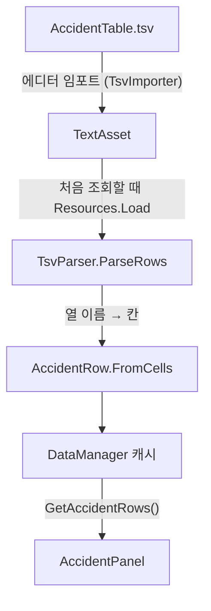

### 3.2 사용법

**조회.** 표는 처음 조회할 때 읽히므로, 쓰는 쪽은 초기화를 신경 쓰지 않고 바로 부릅니다.

```csharp
// GameManager.cs — 지금 항해 번호의 난이도 행 (10번째 이후는 마지막 행)
public VoyageRow Voyage => DataManager.GetVoyage(VoyageIndex);

// ItemObject.cs — 재료 프리팹은 어떤 재료인지(ID)만 갖고, 이름·생성 비중은 표에서 읽는다
public ItemRow Row => DataManager.GetItem(itemId);
```

**TSV 작성 규칙.** 아래는 `AccidentTable`의 일부입니다 (실제 파일은 탭으로 구분, 설명 열 생략).

```text
AccidentID  Name         TimeLimit      SuccessCount                    StabilityPenalty                  SpawnWeight
#사고 ID    이름         제한시간 (초)  해결에 필요한 성공 횟수 (누적)  시간 초과 시 코어 안정도 감소 (%)  사고 종류를 뽑는 비중
TimingBar   패널 수리    30             3                               10                                1
Sequence    회로 재입력  30             3                               10                                1
Wire        전선 연결    30             3                               10                                1
```

1. 첫 줄은 영어 열 이름입니다. 코드는 이 이름으로 칸을 찾습니다.
2. 둘째 줄은 `#`으로 시작하는 한글 설명입니다. 파서가 건너뜁니다.
3. ID 값은 C# enum 이름과 같습니다 (`TimingBar` ↔ `AccidentType.TimingBar`).
4. 한 칸에 여러 값을 넣을 때는 구분자를 씁니다 (예: 주문 재료 `Scrap:2|Crystal:1`).

**새 표를 추가할 때는** ① TSV 파일 추가 → ② 행 클래스와 `FromCells` 작성 → ③ `DataManager`에 조회 함수 추가만 하면 됩니다. 파서는 고치지 않습니다.

### 3.3 핵심 동작

**① 파서: 열 이름을 키로 칸을 찾는다**

```csharp
// TsvParser.cs — 첫 줄은 열 이름(코드가 칸을 찾는 키)이고, #으로 시작하는 한글 설명 줄은 건너뛴다
public static List<TRow> ParseRows<TRow>(string tsvText, Func<Dictionary<string, string>, TRow> fromCells)
{
    List<TRow> rowList = new List<TRow>();
    string[] lines = tsvText.TrimStart('').Split('\n');   // BOM 제거
    string[] header = lines[0].Trim().Split('\t');

    for (int lineIndex = 1; lineIndex < lines.Length; lineIndex++)
    {
        string line = lines[lineIndex].Trim();
        if (line.Length == 0 || line.StartsWith("#")) continue;

        string[] values = line.Split('\t');
        Dictionary<string, string> cells = new Dictionary<string, string>();
        for (int index = 0; index < header.Length; index++)
        {
            cells[header[index].Trim()] = index < values.Length ? values[index].Trim() : "";
        }
        rowList.Add(fromCells(cells));
    }
    return rowList;
}
```

- 칸을 **열 번호가 아니라 열 이름으로** 찾습니다. 표에 열을 추가하거나 순서를 바꿔도 기존 코드가 깨지지 않습니다.
- 한 줄을 행 객체로 바꾸는 방법은 `fromCells` 함수로 받습니다(제네릭). 파서 하나가 모든 표에 쓰입니다.
- `#` 줄과 빈 줄은 건너뛰고, 엑셀이 UTF-8로 저장할 때 붙이는 BOM을 지웁니다.

**② 행 변환: 오타는 표를 읽는 순간 드러난다**

```csharp
// Accident.cs — 칸 이름으로 값을 꺼내 형식을 바꾼다
public static AccidentRow FromCells(Dictionary<string, string> cells)
{
    return new AccidentRow
    {
        AccidentID = TsvParser.ToEnum<AccidentType>(cells["AccidentID"]),
        Name = cells["Name"],
        Desc = cells["Desc"],
        TimeLimit = TsvParser.ToFloat(cells["TimeLimit"]),
        SuccessCount = TsvParser.ToInt(cells["SuccessCount"]),
        StabilityPenalty = TsvParser.ToFloat(cells["StabilityPenalty"]),
        SpawnWeight = TsvParser.ToFloat(cells["SpawnWeight"]),
    };
}

// TsvParser.cs — TSV ID가 enum에 없으면 여기서 예외가 나서 오타를 바로 알 수 있다
public static T ToEnum<T>(string raw) where T : struct, Enum
{
    return Enum.Parse<T>(raw);
}
```

- ID를 enum으로 바꾸다 실패하면 예외가 납니다. TSV에 `Timingbar` 같은 오타가 있으면, 그 행이 뽑힐 때가 아니라 **표를 처음 읽을 때 모든 행을 변환하면서** 드러납니다 (Fail-fast).
- 숫자는 `CultureInfo.InvariantCulture`로 읽어, 소수점을 쉼표로 쓰는 지역 설정에서도 `0.02`가 같은 값이 됩니다.

**③ 지연 로드와 범위 처리**

```csharp
// DataManager.cs — 항해 번호(1부터)의 행. 표의 마지막 항해보다 뒤면 마지막 행
public static VoyageRow GetVoyage(int voyageIndex)
{
    if (voyageTable == null) voyageTable = TsvParser.ParseRows(LoadTsv("VoyageTable"), VoyageRow.FromCells);
    int rowIndex = Mathf.Clamp(voyageIndex, 1, voyageTable.Count) - 1;
    return voyageTable[rowIndex];
}

private static string LoadTsv(string tableName)
{
    TextAsset tsvAsset = Resources.Load<TextAsset>(TsvFolder + tableName);
    if (tsvAsset == null) throw new KeyNotFoundException("Resources/" + TsvFolder + tableName + ".tsv 파일이 없습니다.");
    return tsvAsset.text;
}
```

- `DataManager`는 static 클래스라 씬에 오브젝트를 둘 필요도, 초기화 순서를 맞출 필요도 없습니다. 처음 조회할 때 한 번 읽고 캐시합니다.
- 게임은 게임오버까지 끝없이 이어지므로, 표의 마지막(10번째) 항해 뒤로는 마지막 행을 계속 씁니다.
- 파일이 없으면 경로를 담은 예외를 내서 누락을 바로 알 수 있습니다.

**④ 임포터: .tsv를 텍스트 에셋으로**

```csharp
// TsvImporter.cs (Editor 폴더) — Unity는 .tsv를 TextAsset으로 읽지 않으므로 직접 TextAsset으로 가져온다
[ScriptedImporter(1, "tsv")]
public class TsvImporter : ScriptedImporter
{
    public override void OnImportAsset(AssetImportContext context)
    {
        TextAsset textAsset = new TextAsset(File.ReadAllText(context.assetPath));
        context.AddObjectToAsset("text", textAsset);
        context.SetMainObject(textAsset);
    }
}
```

`ScriptedImporter`로 `.tsv` 확장자를 등록해 `Resources.Load<TextAsset>`으로 읽을 수 있게 했습니다. `Editor` 폴더에 있어 빌드에는 포함되지 않습니다.

### 3.4 고민과 선택

**결정 1. 밸런스 표를 어떤 형식으로 둘까?**

> **[대안 A] CSV**
> - 장점: 스프레드시트의 기본 형식이라 가장 익숙하다.
> - 단점: 이름·설명 칸에 쉼표가 들어가면 열이 밀린다. 막으려면 따옴표 규칙(`"a, b"`, `""`)을 처리하는 파서가 필요하다.
>
> **[대안 B] TSV**
> - 장점: 탭은 문장에 거의 쓰지 않아 `Split('\t')`만으로 충분하다. 스프레드시트에서 복사·붙여넣기 하면 그대로 탭으로 나뉜다.
> - 단점: Unity가 `.tsv`를 텍스트 에셋으로 가져오지 않아 임포터를 따로 만들어야 한다.
>
> **[대안 C] ScriptableObject 배열**
> - 장점: 타입이 안전하고 인스펙터에서 바로 고친다.
> - 단점: 10행 × 6열 같은 표를 인스펙터에서 한눈에 비교하거나 한꺼번에 고치기 불편하다.
>
> **[결정] TSV.** 처음에는 쉼표로만 나누는 CSV 파서로 시작했지만(10/22), 한글 이름·설명이 들어가는 표에서 쉼표 하나가 열을 밀어 버릴 수 있어 다음 날 TSV로 바꿨습니다(10/23). 따옴표 규칙을 처리하는 CSV 파서를 만드는 대신 **구분자를 문장에 나오지 않는 문자로 바꿔** 파서를 단순하게 유지했고, 대가인 임포터는 10줄로 한 번만 치렀습니다. 표 형태의 데이터는 표 도구에서 고치는 것이 가장 빠르다고 판단해 대안 C는 택하지 않았습니다.

**결정 2. 열 이름을 한글로 쓸까?**

> **[대안 A] 한글 열 이름**
> - 장점: 처음 보는 사람도 바로 읽는다.
> - 단점: 코드가 한글 문자열을 키로 쓴다. 엑셀이 CP949로 저장하면 글자가 깨지고, 띄어쓰기 하나만 달라도 키를 찾지 못한다.
>
> **[대안 B] 영어 열 이름 + `#` 한글 설명 줄**
> - 장점: 코드 키는 안전한 영어로, 사람은 둘째 줄의 설명을 본다.
> - 단점: 줄이 하나 늘고, 파서에 '`#` 줄 건너뛰기' 규칙이 생긴다.
>
> **[결정] 대안 B.** 키가 깨지는 문제는 실행해야만 드러나지만, 설명 줄은 파서 조건 하나(`StartsWith("#")`)로 해결되기 때문입니다. ID 값도 같은 이유로 영어로 둡니다.

**결정 3. ID를 문자열로 둘까, enum으로 둘까?**

> **[대안 A] 문자열 ID**
> - 장점: 표에 새 ID를 적기만 하면 된다.
> - 단점: 오타가 나도 조회에 실패하기 전까지 모르고, 프리팹에서 ID를 손으로 입력해야 한다.
>
> **[대안 B] enum ID**
> - 장점: 오타는 표를 읽을 때 예외로 바로 드러나고, 프리팹 인스펙터에서 드롭다운으로 고른다.
> - 단점: Unity는 enum을 '숫자'로 저장하므로, 선언 순서를 바꾸면 프리팹이 다른 재료를 가리킨다.
>
> **[결정] enum.** 대가는 "새 값은 항상 맨 뒤에 추가한다"는 규칙을 enum 선언 위 주석으로 고정해 막았습니다.

---

## 4. 게임 루프와 씬 간 상태

### 4.1 문제와 구조

**문제.** 크레딧·안정도·항해 번호는 타이틀 → 항해 → 정비 씬을 오가도 이어져야 합니다. 또 주문(`OrderManager`)·사고(`AccidentPanel`)·터미널·정비·정산·게임오버·일시정지·타이틀 화면까지 8개 클래스가 이 값을 바꾸거나 씬을 넘깁니다. 값이 여러 곳에 흩어지면 "어디서 크레딧이 줄었는지" 추적하기 어렵고, 0~100% 제한이나 게임오버 판정이 곳곳에 중복됩니다.

**구조.** `GameManager` 하나가 값과 규칙을 모두 갖습니다.

| 구성 | 방법 |
|---|---|
| 씬을 넘어 유지 | `DontDestroyOnLoad` 싱글톤. 프리팹을 3개 씬에 모두 두어 어느 씬에서 플레이를 시작해도 동작하고, 두 번째부터는 중복으로 파괴된다 |
| 값 보호 | 모든 값은 `{ get; private set; }`. 바꾸는 길은 `GameManager`의 함수뿐 |
| 항해 진행 | `SceneManager.sceneLoaded`로 SPACE 진입을 감지해 항해를 시작하고, `Update`에서 안정도 감소와 남은 시간을 진행 |
| 결과 알림 | `VoyageEnded`(정산 화면), `GameOverHappened`(게임오버 화면) 이벤트 |

값이 바뀌는 경로 하나를 따라가 보면 이렇습니다 (주문 완료).

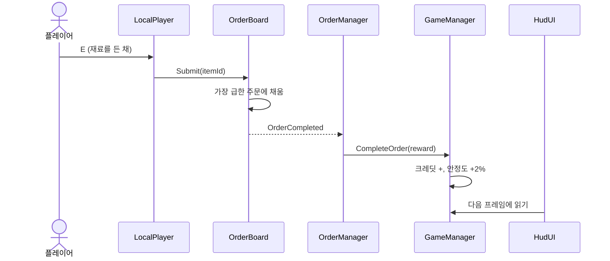

이렇게 바뀐 크레딧·안정도는 [1.1](#11-무엇을-만들었나-what)의 HUD가 다음 프레임에 읽어 표시합니다.

### 4.2 사용법 (API)

| 함수 | 하는 일 | 부르는 곳 |
|---|---|---|
| `ChangeStability(amount)` | 안정도 증감. 0~100%로 자르고, 항해 중 0%가 되면 게임오버 | `AccidentPanel`(시간 초과), 내부(초당 감소·주문·구매) |
| `CompleteOrder(reward)` · `FailOrder()` | 크레딧과 이번 항해 기록 갱신, 안정도 +2% · −5% | `OrderManager` |
| `PayQuota(amount)` | 할당량 납부. 항해 중에 1 ~ 낼 수 있는 최대만 받는다 | `TerminalUI` |
| `BuyStabilizer()` | 60 크레딧으로 안정도 +10%. 가득 찼거나 크레딧이 모자라면 무시 | `TerminalUI`, `MaintenanceUI` |
| `FinishSettlement()` | 도착 보상 지급 후 정비 씬으로 | `SettlementUI` |
| `StartNextVoyage()` | 항해 번호 +1 후 항해 씬으로 | `MaintenanceUI` |
| `StartGame()` · `GoToTitle()` · `AbandonVoyage()` | 새 게임 · 타이틀로 · 항해 포기(기록 저장 후 타이틀) | `TitleUI`, `GameOverUI`, `PauseUI` |

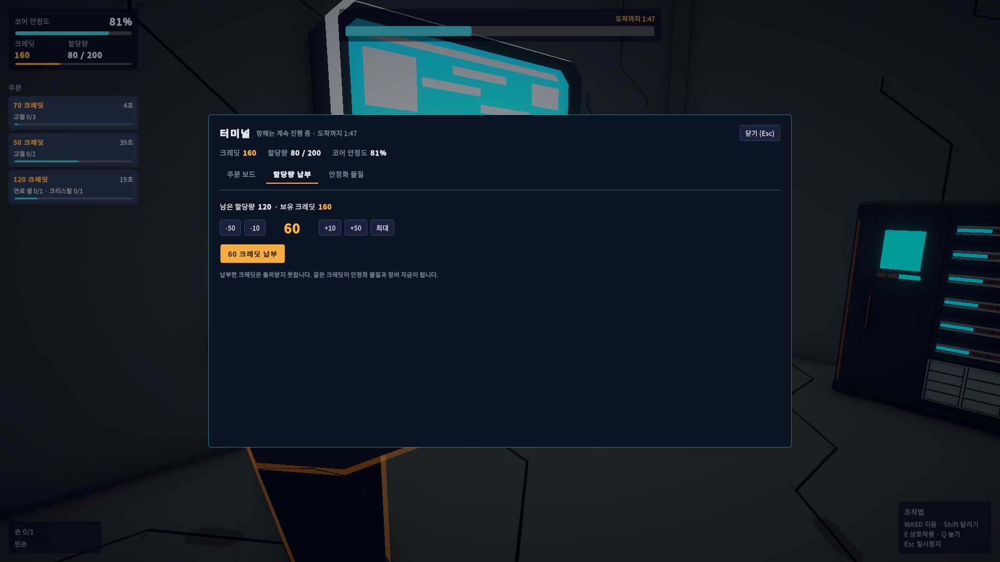

*터미널의 할당량 납부 탭. 낼 금액은 화면(`TerminalUI`)이 고르지만, 실제로 크레딧을 빼고 할당량에 더하는 일은 '납부' 버튼이 부르는 `GameManager.PayQuota` 하나뿐입니다. 같은 크레딧이 안정화 물질 탭에서는 `BuyStabilizer`로 쓰입니다.*

화면은 결과 이벤트를 구독해 열립니다.

```csharp
// SettlementUI.cs — 씬을 넘어 살아남는 GameManager를 구독하므로, 이 화면이 사라질 때 반드시 해제한다
private void Start()
{
    gameManager = GameManager.Instance;
    gameManager.VoyageEnded += Show;
    nextButton.onClick.AddListener(gameManager.FinishSettlement);
    settlementPanel.SetActive(false);
}

private void OnDestroy()
{
    if (gameManager != null) gameManager.VoyageEnded -= Show;
}
```

`GameManager`는 씬이 바뀌어도 살아 있지만, 정산 화면은 SPACE 씬과 함께 사라집니다. 해제하지 않으면 다음 항해에 도착할 때 이미 파괴된 화면의 `Show`가 불려 오류가 납니다. 그래서 구독은 `Start`, 해제는 `OnDestroy`에서 짝지어 하고, 해제할 때는 `Start`에서 받아 둔 참조를 null 확인 후 씁니다 (게임을 끌 때는 `GameManager`가 먼저 파괴될 수 있음).

### 4.3 핵심 동작

항해 진행과 두 가지 실패 조건은 모두 아래 코드에 있습니다.

```csharp
// GameManager.cs (발췌)
private void Update()
{
    if (IsPlaying == false) return;

    // 안정도는 초당 BaseDecay씩 줄고, 0%가 되면 ChangeStability가 게임오버를 낸다
    ChangeStability(-Voyage.BaseDecay * Time.deltaTime);
    if (IsPlaying == false) return;                                     // ①

    RemainingTime -= Time.deltaTime;
    if (RemainingTime <= 0f) Arrive();
}

// 도착. 할당량을 다 냈으면 정산, 못 냈으면 게임오버
private void Arrive()
{
    RemainingTime = 0f;
    if (IsQuotaPaid == false)
    {
        GameOver(GameOverReason.QuotaUnpaid);
        return;
    }
    IsPlaying = false;
    VoyageEnded?.Invoke();
}

// 0 ~ MaxStability로 자르고, 항해 중 0%가 되면 게임오버
public void ChangeStability(float amount)
{
    Stability = Mathf.Clamp(Stability + amount, 0f, coreConfig.MaxStability);
    if (IsPlaying && Stability <= 0f) GameOver(GameOverReason.StabilityZero);   // ②
}

private void GameOver(GameOverReason reason)
{
    IsPlaying = false;
    LastGameOverReason = reason;
    IsNewRecord = Record.TryUpdate(CompletedVoyageCount, TotalEarnedCredit);   // ③
    GameOverHappened?.Invoke();
}
```

1. **같은 프레임 중복 방지.** 안정도 감소로 이번 프레임에 게임오버가 났다면 도착 판정을 하지 않습니다. 게임오버와 정산 화면이 동시에 뜨는 일이 없습니다.
2. **판정은 한 곳에.** 안정도를 바꾸는 모든 길(초당 감소·주문·사고·구매)이 이 함수를 지나므로, 0~100% 제한과 0% 게임오버 판정이 한 곳에만 있습니다. `IsPlaying` 조건 덕분에 정비 씬처럼 항해 밖에서는 게임오버가 나지 않습니다.
3. **기록.** '완료한 항해 수'(지금 항해는 세지 않음)가 많으면, 같으면 누적 크레딧이 많을 때만 JSON에 저장합니다.

### 4.4 고민과 선택

**결정 1. 씬을 넘는 값을 어디에 둘까?**

> **[대안 A] static 클래스**
> - 장점: 가장 단순하고 씬과 무관하다.
> - 단점: MonoBehaviour가 아니라 `Update`로 시간을 진행할 수 없고, 설정 SO를 인스펙터로 연결할 수 없다.
>
> **[대안 B] ScriptableObject에 런타임 값 저장**
> - 장점: 씬과 무관하고 인스펙터에서 값이 보인다.
> - 단점: 에디터에서는 플레이 중 바뀐 값이 에셋에 남아 매번 초기화를 관리해야 하고, 시간을 진행할 MonoBehaviour가 따로 필요하다.
>
> **[대안 C] `DontDestroyOnLoad` 싱글톤 MonoBehaviour**
> - 장점: `Update`로 항해 시간과 안정도 감소를 진행하고, `sceneLoaded`를 구독하고, 설정 SO를 인스펙터로 연결한다.
> - 단점: 어디서든 접근할 수 있어 결합도가 높아지고, 생명주기 함정이 있다 ([8.2 ①](#82-문제-해결-경험)).
>
> **[결정] 대안 C.** 이 게임의 값은 '보관'만 되는 것이 아니라 매 프레임 '진행'되어야 했습니다(안정도 감소, 도착까지 남은 시간). 대가인 결합도는 "값은 `private set`, 바꾸는 길은 `GameManager` 함수뿐" 규칙으로 줄였습니다.
> 싱글톤의 함정도 규칙으로 막았습니다. 공용 `SingletonBase`의 `Instance`는 씬에 오브젝트가 없으면 새로 만들기 때문에, 정비 씬에서 `OrderManager.Instance`를 부르면 설정이 빠진 가짜 매니저가 생겨 다음 항해 씬의 진짜 매니저를 중복으로 파괴합니다. 그래서 **SPACE 밖의 씬은 `GameManager` 함수만 부르도록** 했습니다 (정비 화면의 안정화 물질 구매도 `GameManager.BuyStabilizer`).

**결정 2. 화면은 값을 어떻게 알아낼까? (이벤트 vs 매 프레임 읽기)**

> **[대안 A] 값이 바뀔 때마다 이벤트 (`StabilityChanged` 등)**
> - 장점: 바뀔 때만 그린다.
> - 단점: 안정도와 남은 시간은 매 프레임 바뀌므로 결국 매 프레임 이벤트가 발생한다. 구독·해제 짝을 화면마다 관리해야 한다.
>
> **[대안 B] 화면이 매 프레임 값을 읽음 (폴링)**
> - 장점: 구독이 없어 놓칠 일도, 해제할 일도 없다. 화면을 늦게 열어도 첫 프레임부터 정확한 값이 보인다.
> - 단점: 바뀌지 않은 값도 매 프레임 다시 그린다.
>
> **[결정] 둘을 나눠 썼습니다.** 계속 변하는 값(안정도·남은 시간·주문 시간)은 HUD와 터미널이 매 프레임 읽고, 한 번만 일어나는 사건(도착·게임오버)은 이벤트로 알려 화면이 정확히 한 번 열리게 했습니다. 판단 기준은 **"그 값이 얼마나 자주 바뀌는가"** 였습니다. 폴링의 비용(매 프레임 문자열 생성)은 [8.3](#83-아쉬운-점과-향후-계획)에 개선 과제로 남겼습니다.

---

## 5. 재료 흐름과 오브젝트 풀링

### 5.1 문제와 구조

**문제.**

1. 재료는 초당 1.5개씩 생겨 약 30초 흐른 뒤 사라집니다. 평균 45개가 동시에 떠 있고, 항해 1회(180~360초)에 270~540개가 생겼다 사라집니다. 매번 `Instantiate`/`Destroy`하면 생성 비용과 가비지가 항해 내내 반복됩니다.
2. 선외로 나가는 에어락은 함선 **지붕**에 있습니다. 재료가 아무 방향으로나 흐르면 상당수가 함선 아래나 먼 곳을 지나가 잡을 수 없습니다.

**구조.**

| 단계 | 방법 | 조절 위치 |
|---|---|---|
| 풀 준비 | SPACE 씬을 열 때 종류마다 30개(3종 → 90개)를 꺼 둔 채 만든다. 물리 계산이 필요 없어 kinematic, 선외에서 잘 보이도록 5배 크기 | `SpawnConfig` |
| 생성 | 항해 중에만 1.5개/초. 종류는 생성 비중(고철 5 : 연료 셀 3 : 크리스탈 2)으로 뽑는다 | `SpawnConfig`, `ItemTable` |
| 흐름 | 생성 구(반지름 45 m)의 위쪽 반구에서 출발해, 함선 구(반지름 25 m)의 위를 스치는 직선을 등속으로 이동 | 씬의 구 스케일, `SpawnConfig` |
| 반납 | 반대편 표면에 닿거나 플레이어가 잡으면 꺼서 풀로 돌려보낸다 | |

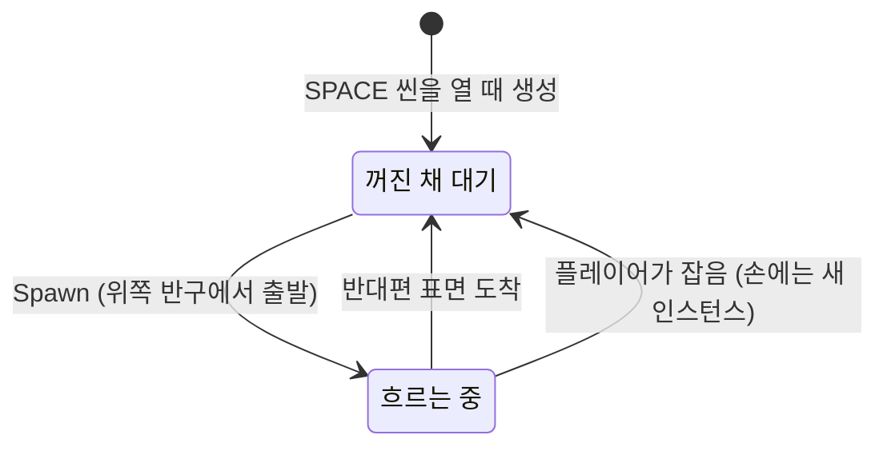

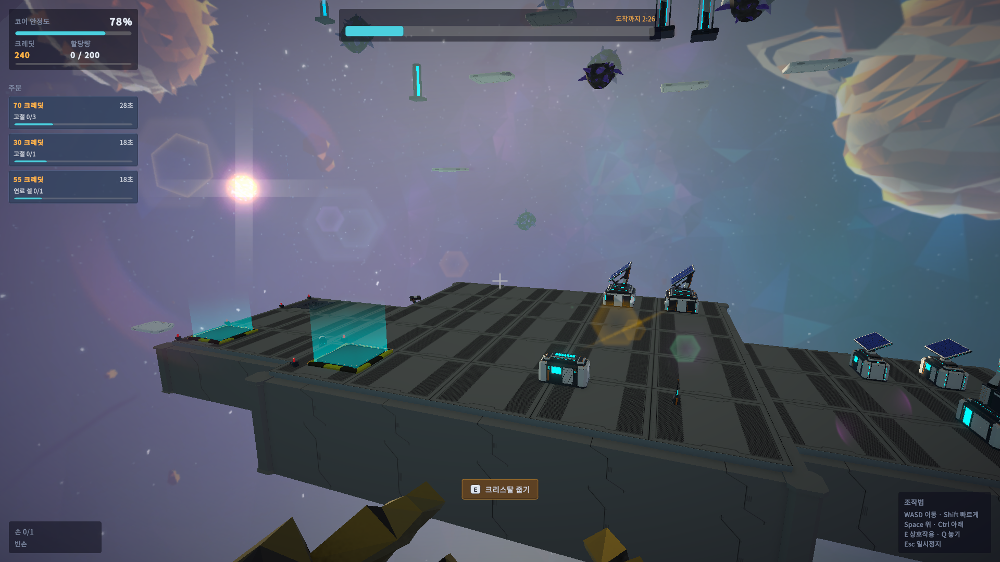

*지붕 에어락(왼쪽의 하늘색 패드 2개)으로 나온 플레이어 시점. 재료가 모두 함선 위쪽을 지나가므로 지붕 근처에서 바로 잡을 수 있고, 가까이 오면 "E 크리스탈 줍기" 안내가 뜹니다.*

### 5.2 사용법

생성은 `SpawnManager`가 항해 중에 알아서 합니다. 바깥에서 부르는 함수는 하나뿐입니다.

```csharp
// LocalPlayer.cs — E로 재료를 잡을 때. 흐르던 재료를 넘기면 손에 들 재료를 돌려받는다
Item = SpawnManager.Instance.TakeItem(item);
```

| 바꾸고 싶은 것 | 고칠 곳 |
|---|---|
| 재료 종류별 생성 비중 | `ItemTable.tsv`의 `SpawnWeight` |
| 생성 속도, 흐름 속도, 풀 크기, 흐를 때 크기 배율 | `SpawnConfig` |
| 생성 범위, 함선 범위 | 씬의 `SpawnSphere`·`SafeSphere` 스케일 (반지름 = 스케일 ÷ 2) |

### 5.3 핵심 동작

**① 흐름 경로: 위쪽에서 출발해 함선 위를 스친다**

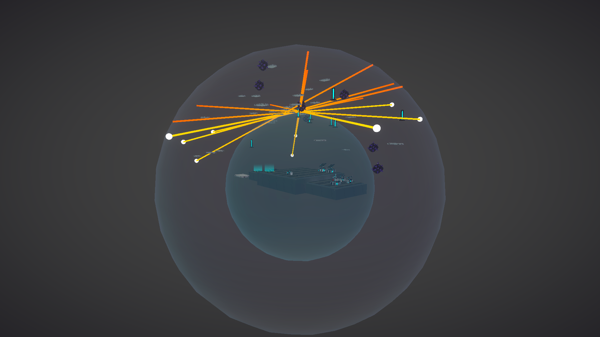

*Scene 뷰에서 본 흐름 구조. 바깥 구가 생성 구(반지름 45 m), 안쪽 구가 함선 구(반지름 25 m)입니다. 노란 선은 `Spawn()`이 만드는 경로의 예시이고 흰 점이 출발점입니다. 위쪽 반구에서 출발한 모든 경로가 함선 구의 꼭대기 쪽을 스쳐 지나갑니다.*

- 재료는 생성 구의 **위쪽 반구에서만** 출발합니다. 지붕 에어락으로 나간 플레이어가 함선 아래로 갈 일이 없기 때문입니다.
- 출발한 재료는 함선 중심을 곧장 향하지 않고, 조금 위로 비껴 **함선 구의 꼭대기를 스치는 직선**으로 날아갑니다. 그래서 함선을 뚫고 지나가지 않고, 모두 지붕 근처를 지나갑니다.
- 이동은 물리 대신 트윈(DOTween)으로 처리합니다. 출발점·도착점·시간만 정해 일정한 속도로 옮기고, 도착하면 풀로 돌려보냅니다.

이 씬에서는 두 구의 중심이 같아 **모든 경로의 길이가 약 74.8 m로 같습니다.** 흐르는 속도가 초당 2.5 m이므로 재료 하나가 흐르는 시간은 약 30초이고, 동시에 떠 있는 개수(1.5개/초 × 30초 ≈ 45개, 그중 고철 약 22개)도 미리 계산할 수 있습니다. 그래서 종류당 30개인 풀이 충분한지 확인할 수 있었습니다.

**② 생성 주기: 넘친 시간을 버리지 않는다**

```csharp
// SpawnManager.cs — 항해 중에만 초당 BaseSpawnRate개씩 만든다. 넘친 시간은 남겨 개수를 맞춘다
private void Update()
{
    if (GameManager.Instance.IsPlaying == false) return;

    spawnTimer += Time.deltaTime;
    float spawnInterval = 1f / spawnConfig.BaseSpawnRate;
    if (spawnTimer < spawnInterval) return;
    spawnTimer -= spawnInterval;

    float[] weights = new float[itemPrefabs.Length];
    for (int index = 0; index < itemPrefabs.Length; index++) weights[index] = itemPrefabs[index].Row.SpawnWeight;
    ItemObject itemPrefab = itemPrefabs[WeightedRandom.PickIndex(weights)];
    ItemObject item = GetInactiveItem(itemPrefab.ItemID);
    if (item != null) Spawn(item);
}
```

- 타이머를 0으로 되돌리지 않고 간격만큼 빼서, 프레임 시간이 들쭉날쭉해도 길게 보면 정확히 초당 1.5개가 됩니다.
- 해당 종류의 풀이 바닥나면 예외 없이 이번 회차만 건너뜁니다.

**③ 잡기: 풀은 줄지 않는다**

```csharp
// SpawnManager.cs
// 잡은 재료. 흐르는 풀 재료는 풀로 돌려보내고 같은 종류의 새 인스턴스를 준다 (풀이 줄지 않아 생성 비율이 유지된다)
// 프리팹에서 만들어야 OriginalScale이 풀 크기로 잡히지 않는다. 놓아 둔 재료는 그대로 준다
public ItemObject TakeItem(ItemObject item)
{
    if (pooledItems.Contains(item) == false) return item;

    ReturnItem(item);
    return Instantiate(GetPrefab(item.ItemID));
}

private void ReturnItem(ItemObject item)
{
    item.transform.DOKill();    // 반납할 때 트윈을 멈춰, 꺼진 재료가 계속 끌려가지 않게 한다
    item.gameObject.SetActive(false);
}
```

### 5.4 고민과 선택

**결정 1. 재료가 어느 방향으로 흐르게 할까?**

> **[대안 A] 완전 무작위 방향**
> - 장점: 가장 단순하다.
> - 단점: 함선과 먼 곳이나 아래쪽을 지나는 재료가 많아, 지붕 에어락으로 나온 플레이어가 잡을 수 있는 재료가 적다.
>
> **[대안 B] 함선 중심을 향해**
> - 장점: 모든 재료가 함선 근처로 온다.
> - 단점: 함선을 관통한다 (선체 안으로 사라지거나 선내에 떠다닌다).
>
> **[대안 C] 위쪽 반구에서 출발해 함선 위를 스치는 방향**
> - 장점: 모든 재료가 지붕 근처를 지나 동선이 짧다. 경로 길이가 일정해 흐르는 시간과 동시 개수를 계산할 수 있다.
> - 단점: 방향을 정하는 계산이 조금 더 필요하고, 경로가 모두 함선 위쪽에 모여 흐름이 단조로워질 수 있다.
>
> **[결정] 대안 C.** 플레이어가 지붕 에어락으로만 드나드는 함선 구조에 맞췄습니다. '경로 길이가 일정하다'는 성질 덕분에 풀 크기를 감이 아니라 계산으로 점검할 수 있게 되었습니다.

**결정 2. 플레이어가 잡은 재료를 어떻게 처리할까?**

> **[대안 A] 흐르던 풀 오브젝트를 그대로 손에 든다**
> - 장점: 추가 생성이 없다.
> - 단점: 제출하면 파괴되고, 놓으면 그 자리에 남아 풀이 계속 줄어든다. 결국 그 종류는 생성이 멈춘다. 흐를 때의 크기(5배)·물리 상태도 손에 들 때마다 되돌려야 한다.
>
> **[대안 B] 풀 오브젝트는 바로 반납하고, 손에는 프리팹에서 새로 만든 재료를 준다**
> - 장점: 풀은 '흐르는 재료' 전용으로 개수가 늘 일정해 생성 비율이 유지된다. 손에 든 재료는 보통 오브젝트라 제출할 때 그냥 파괴하면 된다.
> - 단점: 잡을 때마다 `Instantiate`가 한 번 일어난다.
>
> **[결정] 대안 B.** 잡는 횟수는 플레이어가 직접 E를 눌러야 해서 생성 횟수(항해 1회 270~540번)보다 훨씬 적습니다. 적은 비용으로 **"풀은 줄지 않는다"는 불변 조건**을 구조로 지키는 쪽을 택했습니다. 이때 풀 오브젝트가 아니라 **프리팹에서** 복제해야 '놓을 때 되돌릴 원래 크기'가 5배로 잡히지 않습니다.

---

## 6. 사고와 미니게임

### 6.1 문제와 구조

**문제.**

- 항해 중 30~60초 간격(항해가 거듭될수록 30~50초)으로 함선 패널 3곳 중 한 곳에 사고가 납니다. 30초 안에 미니게임에서 3번 성공해야 해결되고, 넘기면 안정도가 10% 깎입니다.
- 미니게임 3종은 조작이 모두 다릅니다 (Space 타이밍 / 방향키 순서 / 마우스로 전선 잇기). 하지만 규칙은 같습니다: 제한시간, **누적** 성공(실패해도 줄지 않음), 화면을 닫아도 사고·시간·성공 횟수 유지.
- 플레이어는 사고 중에도 재료를 잡으러 나갈 수 있어야 합니다. 화면을 닫았다 다시 열면 이어서 해야 합니다.

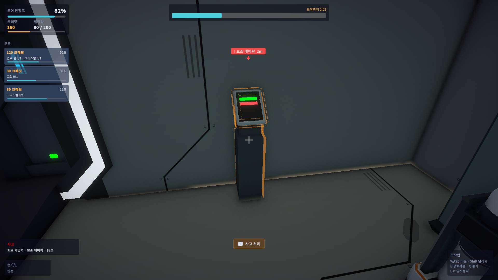

*사고가 난 패널. 패널 위에 장소와 거리가 표시되고(화면 밖이면 가장자리 화살표), 왼쪽 아래 알림에 사고 종류와 남은 시간이 뜹니다. 패널 앞에서 E를 누르면 미니게임 화면이 열립니다.*

| 타이밍 바 | 순서 입력 | 전선 잇기 |
|---|---|---|
| 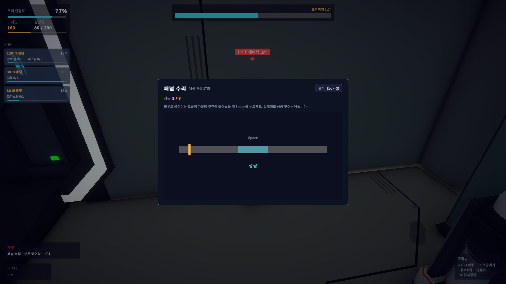 | 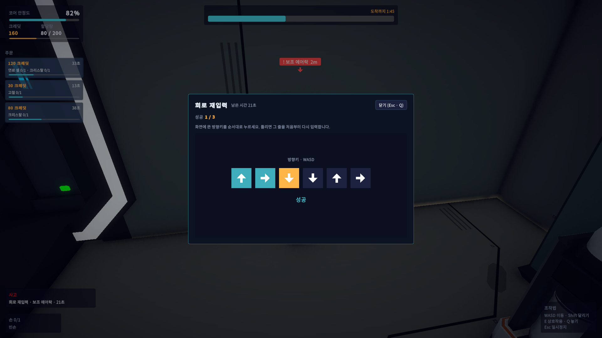 | 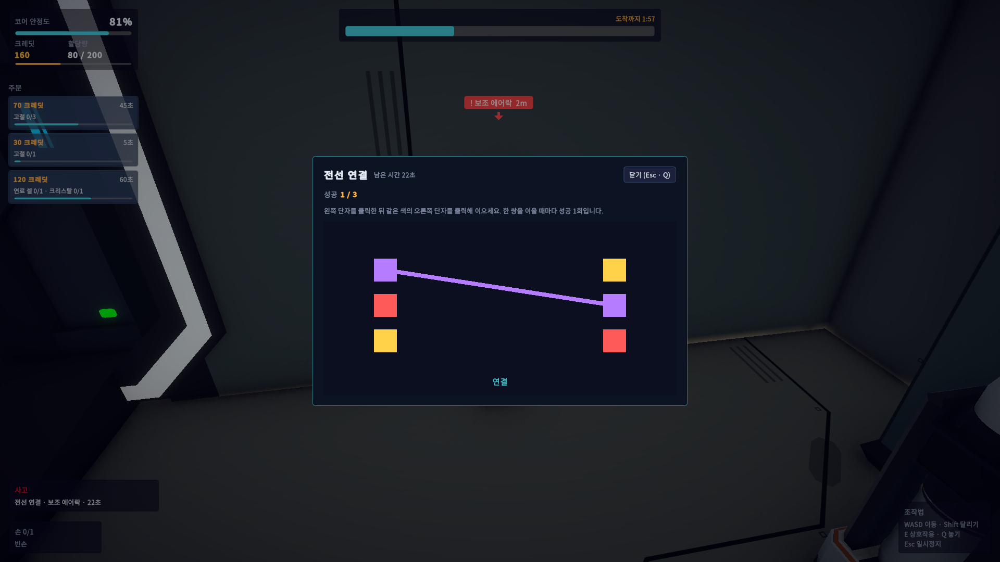 |

*조작은 Space, 방향키, 마우스로 모두 다르지만, 세 화면의 위쪽(제목·남은 시간·"성공 n / 3")은 똑같습니다. 이 공통 부분은 `MiniGameUI`가 그리고, 가운데 내용만 종류별 `MiniGame`이 그립니다. 전선 잇기는 한 쌍을 이을 때마다 성공 1회입니다.*

**구조.**

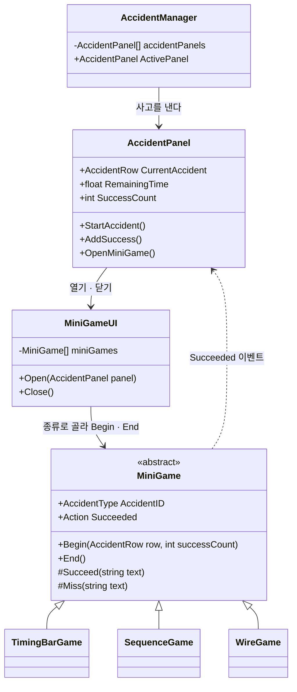

| 클래스 | 갖는 것 | 하는 일 | 하지 않는 일 |
|---|---|---|---|
| `AccidentManager` | 패널 3개, 다음 사고까지 남은 시간 | 항해 번호별 간격(`VoyageTable`)이 지나면 패널 하나에 사고를 낸다. 사고가 끝나야 다음 간격을 센다 | 사고 진행·판정 |
| `AccidentPanel` | 사고 종류(`AccidentRow`), 남은 시간, 성공 횟수 | 종류 뽑기(비중), 시간 초과 시 안정도 감소, 성공 누적과 해결 판정 | 화면·입력 |
| `MiniGameUI` | 지금 연 패널, 지금 미니게임 | 종류에 맞는 미니게임 선택, 제목·남은 시간·"1 / 3" 표시, 성공 이벤트 연결 | 판정 |
| `MiniGame` (3종) | 종류별 화면 요소 | 입력을 받아 성공 1회 / 빗나감 판정 | 누적 횟수·제한시간 |

### 6.2 사용법: 새 미니게임 추가하기

1. `AccidentType` enum **맨 뒤에** 종류를 추가한다.
2. `MiniGame`을 상속해 `AccidentID`와 `Begin`/`End`를 구현하고, 성공 1회마다 `Succeed()`, 빗나가면 `Miss()`를 부른다.
3. `AccidentTable.tsv`에 한 줄을 추가한다 (이름, 설명, 제한시간, 성공 횟수, 안정도 감소, 비중).
4. `MiniGameUI`의 `miniGames` 배열에 연결한다.

`AccidentManager`, `AccidentPanel`, `MiniGameUI`는 고치지 않습니다. 자식 클래스가 알아야 할 계약은 이것뿐입니다.

```csharp
// MiniGame.cs (발췌) — 화면이 열리면 Begin, 닫히면 End. 해결 판정과 제한시간은 AccidentPanel이 맡는다
public abstract class MiniGame : MonoBehaviour
{
    public abstract AccidentType AccidentID { get; }

    public Action Succeeded;    // MiniGameUI가 구독해 AccidentPanel에 넘긴다

    // successCount는 이번 사고에서 이미 모은 성공 횟수 (닫았다 다시 열면 이어서 한다)
    public virtual void Begin(AccidentRow accidentRow, int successCount)
    {
        resultValue.text = "";
        gameObject.SetActive(true);
    }

    public virtual void End()
    {
        gameObject.SetActive(false);
    }

    protected void Succeed(string resultText)
    {
        ShowResult(resultText, successColor);
        Succeeded?.Invoke();
    }

    protected void Miss(string resultText)
    {
        ShowResult(resultText, missColor);
    }
}
```

가장 짧은 구현인 타이밍 바는 입력과 판정만 갖습니다.

```csharp
// TimingBarGame.cs (발췌) — 좌우로 움직이는 토글이 가운데 구간에 있을 때 Space를 누르면 성공 1회
public override AccidentType AccidentID => AccidentType.TimingBar;

// 토글 위치 (0 = 왼쪽 끝, 1 = 오른쪽 끝). 끝에 닿으면 되돌아온다
private float CursorValue => Mathf.PingPong(movedTime * miniGameConfig.TimingCursorSpeed, 1f);

private void Update()
{
    movedTime += Time.deltaTime;
    missLockTime -= Time.deltaTime;
    DrawCursor();

    if (SimpleInput.GetKeyDown(Key.Space)) Press();
}

private void Press()
{
    if (missLockTime > 0f) return;      // 빗나간 직후 0.5초는 받지 않는다 (연타 방지)

    float cursorValue = CursorValue;
    if (cursorValue >= ZoneMin && cursorValue <= ZoneMax)
    {
        movedTime = 0f;                 // 성공하면 왼쪽 끝에서 다시 출발
        Succeed("성공");
        return;
    }

    missLockTime = miniGameConfig.TimingMissLockTime;
    Miss("빗나감");
}
```

입력 읽기(`Update`)와 판정(`Press`)을 나눠, 키 입력 없이도 판정 함수만 불러 결과를 확인할 수 있게 했습니다.

### 6.3 핵심 동작

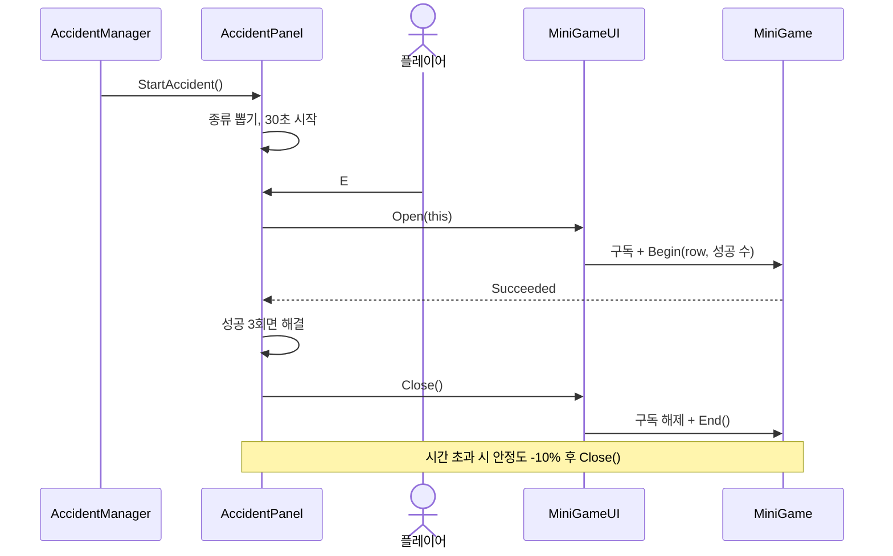

**① 상태와 판정은 패널에**

```csharp
// AccidentPanel.cs (발췌)
private void Update()
{
    if (GameManager.Instance.IsPlaying == false) return;
    if (IsAccident == false) return;

    RemainingTime -= Time.deltaTime;            // 화면이 닫혀 있어도 시간은 패널이 센다
    if (RemainingTime <= 0f) FailAccident();
}

// 미니게임 성공 1회 (MiniGameUI)
public void AddSuccess()
{
    if (IsAccident == false) return;            // 이미 끝난 사고에 늦게 온 성공은 무시

    SuccessCount++;
    if (SuccessCount >= CurrentAccident.SuccessCount) EndAccident();
}

// AccidentManager가 부른다
public void StartAccident()
{
    IReadOnlyList<AccidentRow> accidentRows = DataManager.GetAccidentRows();
    float[] weights = new float[accidentRows.Count];
    for (int index = 0; index < accidentRows.Count; index++) weights[index] = accidentRows[index].SpawnWeight;
    CurrentAccident = accidentRows[WeightedRandom.PickIndex(weights)];
    RemainingTime = CurrentAccident.TimeLimit;
    SuccessCount = 0;
}

private void FailAccident()
{
    GameManager.Instance.ChangeStability(-CurrentAccident.StabilityPenalty);
    EndAccident();
}

private void EndAccident()
{
    CurrentAccident = null;
    miniGameUI.Close();
}
```

**② 화면은 보여 주고 연결만 한다**

```csharp
// MiniGameUI.cs (발췌)
public void Open(AccidentPanel targetAccidentPanel)
{
    if (IsOpen) return;

    accidentPanel = targetAccidentPanel;
    AccidentRow accidentRow = accidentPanel.CurrentAccident;
    titleValue.text = accidentRow.Name;
    descValue.text = accidentRow.Desc;
    miniGamePanel.SetActive(true);
    playerController.LockForScreen();
    DrawProgress();

    currentMiniGame = FindMiniGame(accidentRow.AccidentID);             // 연결이 빠졌으면 예외
    currentMiniGame.Succeeded += accidentPanel.AddSuccess;
    currentMiniGame.Begin(accidentRow, accidentPanel.SuccessCount);     // 지금까지의 성공 수를 넘겨 이어서
}

// 해결, 시간 초과, 정산·게임오버 화면, Q·Esc·닫기 버튼
public void Close()
{
    if (IsOpen == false) return;

    currentMiniGame.Succeeded -= accidentPanel.AddSuccess;              // 연 곳에서 구독, 닫는 곳에서 해제
    currentMiniGame.End();
    currentMiniGame = null;
    miniGamePanel.SetActive(false);
    playerController.UnlockForScreen();
}
```

이어서 하기는 각 미니게임이 받은 `successCount`로 처리합니다. 예를 들어 전선 잇기는 다시 열면 **남은 쌍만** 만듭니다.

```csharp
// WireGame.cs — 쌍 수는 AccidentTable의 SuccessCount이고, 다시 열면 남은 쌍만 보인다
public override void Begin(AccidentRow accidentRow, int successCount)
{
    base.Begin(accidentRow, successCount);
    MakeTerminals(accidentRow.SuccessCount - successCount);
}
```

**예외 상황 처리**

| 상황 | 처리 |
|---|---|
| 사고가 없는 패널에서 E | 무시. HUD 안내는 "이상 없음"을 흐리게 표시 |
| 화면이 열린 채 다시 `Open` | 무시 (`IsOpen`) |
| 시간 초과 직후 늦게 도착한 성공 | 무시 (`IsAccident == false`) |
| 해당 종류의 미니게임이 연결되지 않음 | `KeyNotFoundException`으로 설정 누락을 바로 알림 |
| 미니게임이 열린 채 도착하거나 게임오버 | 정산·게임오버 화면이 먼저 `Close()`를 부른다 |
| Esc | `PauseUI` 한 곳에서만 받아, 열린 미니게임을 먼저 닫고 그다음 일시정지 |

### 6.4 고민과 선택

**결정 1. 미니게임 3종의 공통 구조**

> **[대안 A] 한 클래스에서 `switch (accidentType)`**
> - 장점: 파일 하나로 끝난다.
> - 단점: 세 종류의 화면 참조와 상태가 한 클래스에 섞이고, 종류를 추가할 때마다 기존 코드를 고친다.
>
> **[대안 B] 인터페이스 `IMiniGame`**
> - 장점: 결합이 가장 느슨하다.
> - 단점: 공통 동작(켜고 끄기, 결과 글자 색, 성공 이벤트)을 구현체마다 반복한다. 또 Unity 인스펙터는 인터페이스 타입 배열을 직렬화하지 못해 `MiniGameUI`에 연결할 수 없다.
>
> **[대안 C] 추상 클래스 `MiniGame : MonoBehaviour`**
> - 장점: 공통 동작은 부모에 한 번, 종류별 입력·판정만 자식에 둔다. `MiniGame[]`으로 인스펙터에 연결할 수 있다.
> - 단점: 단일 상속이라 다른 부모 클래스를 가질 수 없다.
>
> **[결정] 대안 C.** `MiniGameUI`는 종류(enum)로 미니게임을 골라 `Begin`/`End`만 부르고, 그것이 어떤 미니게임인지 모릅니다(전략 패턴). 종류를 추가해도 기존 코드를 고치지 않습니다(개방-폐쇄 원칙). 단일 상속 제약은 미니게임이 다른 부모를 가질 필요가 없어 문제가 되지 않았습니다.

**결정 2. 진행 상태(남은 시간·성공 횟수)를 어디에 둘까?**

> **[대안 A] 미니게임 화면(`MiniGameUI`)에**
> - 장점: 화면 코드 안에서 모두 끝난다.
> - 단점: 화면을 닫으면 진행이 사라지거나, 닫힌 화면이 시간을 세야 한다. 정산·게임오버로 화면이 강제로 닫힐 때 처리가 꼬인다.
>
> **[대안 B] 사고가 난 패널(`AccidentPanel`)에**
> - 장점: 화면은 보여 주기만 하므로, 닫아도 사고·시간·성공 횟수가 남는다. 시간 초과는 화면과 무관하게 패널이 처리한다.
> - 단점: 미니게임이 성공을 직접 처리하지 못하고 이벤트로 넘겨야 해서, 구독·해제 짝을 관리해야 한다.
>
> **[결정] 대안 B.** "실패해도 성공 수는 남는다", "닫아도 사고는 계속된다"는 규칙을 주의가 아니라 구조로 보장하는 쪽입니다. 대가인 구독 관리는 **구독은 `Open`에서, 해제는 `Close`에서만** 하도록 한 곳에 짝지어 해결했습니다.

---

## 7. 기타 구현

| 기능 | 구현 요점 | 클래스 |
|---|---|---|
| 선내 / 선외 이동 | 이동 상태 2개. 선내는 중력과 평면 이동, 선외는 관성 유영. 선외에서는 이동 키를 놓으면 속도가 서서히 줄어든다 | `PlayerController` |
| 선외 활동 범위 | 활동 구 밖으로 나가면 바깥으로 향하는 속도 성분을 없애고 안쪽으로 밀어 낸다 | `PlayerController` |
| 조작 잠금 | bool이 아닌 횟수로 센다. 에어락 통과와 화면 열기가 겹쳐도 모두 풀려야 해제되고, 화면 잠금 중에는 커서를 보인다 | `PlayerController` |
| 에어락 | 0.5초 동안 조작을 잠그고 진행 막대를 채운 뒤 선내 ↔ 지붕으로 옮긴다. `CharacterController`를 끄고 위치를 바꾼 뒤 다시 켠다 | `LocalPlayer`, `AirLock`, `HoldBarUI` |
| 상호작용 | 상자 범위(`OverlapBox`) 안 상호작용 태그 대상 중 가장 가까운 것을 고른다. HUD 안내도 같은 규칙으로 "크리스탈 줍기"를 띄우고, 지금 못 하면 이유("손이 찼음", "맞는 주문 없음")를 흐리게 보인다 | `InteractionCube`, `LocalPlayer`, `InteractionPromptUI` |
| 주문 보드 | MonoBehaviour가 아닌 순수 C# 클래스. 주문 3칸, 제출한 재료는 그 재료가 필요한 주문 중 남은 시간이 가장 짧은 칸에 자동 배정, 끝난 칸은 5초 뒤 새 주문으로 채운다 | `OrderBoard`, `OrderManager` |
| 1인칭 로봇 애니메이션 | 이동 속도에 맞춰 걷기·뛰기 애니메이션을 섞어 발이 미끄러지지 않게 한다. 재료를 들면 두 손이 재료를 쥐고, 1인칭 카메라에 내 머리가 보이지 않게 숨긴다 | `PlayerAnimator`, `FirstPersonHead`, `PlayerCamera` |
| 사고 위치 표시 | 사고 패널 위에 "이름 거리m"를 띄운다. 화면 밖이나 카메라 뒤면 화면 가장자리에 붙이고 화살표로 방향을 가리킨다 | `WorldMarkerUI` |
| 상호작용 대상 빛 | 상호작용할 수 있는 대상은 빛나게 표시한다 | `InteractionHighlight` |
| Esc 처리 | Esc는 `PauseUI` 한 곳에서만 받아 터미널 → 미니게임 → 일시정지 순서로 하나만 처리한다. 화면마다 받으면 한 번 눌러 두 화면이 반응하기 때문이다 | `PauseUI` |

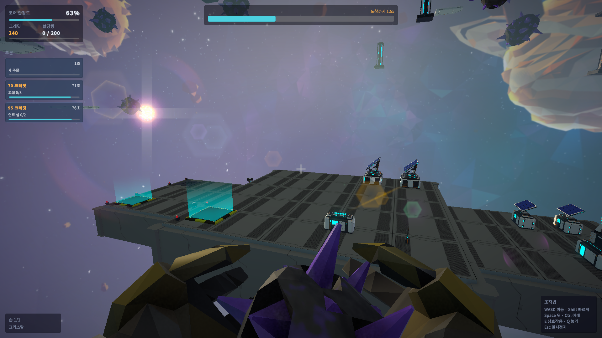

*재료를 든 1인칭 화면. 두 손이 크리스탈 양옆을 쥐고 있고, 왼쪽 아래에는 "손 1/1 크리스탈"이 표시됩니다.*

---

## 8. 결과 및 배운 점

### 8.1 결과

| 개요의 목표 | 결과 | 근거 |
|---|---|---|
| 11/2 시연까지 한 판이 끝까지 도는 버전 | 타이틀 → 항해 → 정산 → 정비 → 다음 항해, 게임오버·최고 기록까지 구현 | 씬 3개, 시연 범위 커밋(11/2) |
| 수치는 코드 밖에서 조정 | 시연 뒤 밸런스 조정 3건이 모두 데이터 수정만으로 끝남 (.cs 변경 0줄) | 아래 표 |
| 흐르는 재료 재사용 | 씬을 열 때 90개를 만든 뒤, 항해 중에는 흐르는 재료를 새로 만들거나 파괴하지 않음 (1항해 270회 생성을 모두 재사용) | `SpawnManager` |
| 같은 규칙의 미니게임 3종 | 공통 흐름 1벌(`AccidentPanel`·`MiniGameUI`) + 종류별 클래스 3개. 종류 추가 = 클래스 1개 + TSV 1줄 + 인스펙터 연결 | `MiniGame` 추상 클래스 |

**수치 조정: 바꾼 곳과 코드 변경량**

| 조정 (2026.11.04) | 바꾼 곳 | 코드 변경 | 커밋 |
|---|---|---|---|
| 재료 생성 비중: 고철 6 → 5, 크리스탈 1.2 → 2 | `ItemTable.tsv` | 0줄 | `d6bae86` |
| 항해 10단계 난이도 곡선: 1항해 시간 240 → 180초, 1항해 사고 간격 50~80 → 30~60초 등 | `VoyageTable.tsv` 10행 | 0줄 | `70edf2f` |
| 재료 풀 크기: 종류당 40 → 30 | `SpawnConfig` 에셋 | 0줄 | `70edf2f` |

### 8.2 문제 해결 경험

**① 씬을 넘기면 GameManager가 사라질 수 있었던 문제**

- **(문제)** 실행 순서에 따라 `GameManager`가 `DontDestroyOnLoad`에 등록되지 않았습니다. 그래서 정비 씬으로 넘어갈 때 파괴되고, 그 씬의 `GameManager`가 새로 시작해 크레딧·안정도가 처음 값으로 돌아갔습니다.
- **(원인)** 공용 `SingletonBase`의 `Instance`는 처음 불릴 때 씬에서 찾은 오브젝트를 instance로 정하지만, `DontDestroyOnLoad`는 **새로 만든 경우에만** 부릅니다. 다른 스크립트가 `GameManager.Awake`보다 먼저 `Instance`를 부르면, 뒤이은 `Awake`에서는 이미 instance가 자기 자신이라 등록을 건너뜁니다.
- **(해결)** `GameManager.Awake`에서 자기 자신이 instance이면 한 번 더 등록합니다. 실행 순서를 `[DefaultExecutionOrder]`로 앞당기는 방법도 있었지만, 지켜야 할 순서 규칙을 하나 늘리는 대신 **순서와 상관없이 항상 성립하는** 쪽을 택했습니다.

```csharp
// GameManager.cs — 다른 스크립트가 Awake보다 먼저 Instance를 부르면 SingletonBase가 DontDestroyOnLoad를 건너뛰므로 한 번 더 건다
protected override void Awake()
{
    base.Awake();
    if (instance == this) DontDestroyOnLoad(gameObject);
}
```

**② 안정도가 '100%'로 보이는데 안정화 물질을 살 수 있던 문제**

- **(문제)** 안정도가 "100%"로 보이는데 구매 버튼이 켜져 있었고, 사면 60 크레딧을 내고 안정도는 0.02%만 올랐습니다.
- **(원인)** 안정도는 매초 조금씩 줄어 99.98%처럼 소수가 되는데, 화면은 올림해 "100%"로 보여 주고 구매 가능 여부는 실제 값(99.98 < 100)으로 판정했습니다. 화면 표기와 판정의 기준이 달랐습니다.
- **(해결)** '가득 참' 판정을 화면과 같은 올림 기준으로 맞췄습니다. 보이는 값과 판정이 어긋나지 않습니다.

```csharp
// GameManager.cs — 화면 표기(올림)가 상한이면 가득 찬 것으로 본다 (99.98%일 때 사서 크레딧만 잃지 않게)
public bool IsStabilityFull => Mathf.CeilToInt(Stability) >= coreConfig.MaxStability;
public bool CanBuyStabilizer => Credit >= coreConfig.StabilizerPrice && IsStabilityFull == false;
```

**③ 비중 뽑기가 경계값에서 아무것도 고르지 못하던 문제**

- **(문제)** 재료 종류와 사고 종류를 비중으로 뽑는 함수가, 드물게 반복문 안에서 아무것도 고르지 못했습니다. 이때 단순히 '마지막 번호'를 돌려주면, 마지막 항목의 비중이 0일 때 나와서는 안 되는 항목이 뽑힙니다.
- **(원인)** `Random.Range(float, float)`는 정수 버전과 달리 **최댓값도 포함**합니다. 뽑은 값이 정확히 비중 합계이면 `pick < weight`가 끝까지 거짓입니다.
- **(해결)** 비중 0인 번호는 건너뛰고, 반복문이 끝나면 **비중이 있는 마지막 번호**를 돌려줍니다. 모두 0이면 −1입니다.

```csharp
// WeightedRandom.cs — 비중이 0인 번호는 나오지 않는다. 모두 0이면 -1
public static int PickIndex(float[] weights)
{
    float total = 0f;
    for (int index = 0; index < weights.Length; index++) total += weights[index];

    float pick = Random.Range(0f, total);
    int lastIndex = -1;     // 비중이 있는 마지막 번호. Random.Range는 total도 내므로 반복문에서 못 고를 수 있다
    for (int index = 0; index < weights.Length; index++)
    {
        if (weights[index] <= 0f) continue;
        if (pick < weights[index]) return index;
        pick -= weights[index];
        lastIndex = index;
    }
    return lastIndex;
}
```

**④ 미니게임을 연 첫 프레임에 전선이 엉뚱한 곳에서 시작하던 문제**

- **(문제)** 전선 잇기 화면을 열자마자 단자를 클릭하면, 전선이 단자가 아닌 엉뚱한 위치에서 시작했습니다.
- **(원인)** 단자는 Layout Group 안에 복제해 만드는데, Layout Group은 자식 위치를 프레임 끝의 캔버스 갱신 때 계산합니다. 만든 바로 그 프레임에는 단자 위치가 아직 정렬 전 값입니다.
- **(해결)** 단자를 만든 직후 정렬을 즉시 계산합니다.

```csharp
// WireGame.cs — 첫 프레임부터 단자 위치로 전선을 그릴 수 있게 정렬을 바로 맞춘다
LayoutRebuilder.ForceRebuildLayoutImmediate(leftColumn);
LayoutRebuilder.ForceRebuildLayoutImmediate(rightColumn);
```

### 8.3 아쉬운 점과 향후 계획

| 아쉬운 점 (기술 부채) | 왜 문제인가 | 향후 계획 (To-Be) |
|---|---|---|
| 상호작용 규칙이 두 곳에 있다 (`LocalPlayer.Interact`, `InteractionPromptUI`) | 대상이 하나 늘 때마다 같은 분기를 두 곳에서 고쳐야 한다 | 대상이 `IInteractable`(안내 문구, 실행)을 직접 구현해 규칙을 한 곳에 모은다 |
| 공용 `SingletonBase`가 씬 전용 매니저(`OrderManager`, `SpawnManager`)에도 `DontDestroyOnLoad`를 건다 | 지금은 부모 오브젝트 아래에 있어 무시될 뿐이고(실행마다 경고 로그), 루트로 옮기면 씬을 넘어 살아남아 다음 항해의 매니저와 충돌한다 | 씬 전용 매니저는 싱글톤 대신 인스펙터 참조로 바꾸고, 씬을 넘는 것은 `GameManager`만 둔다 |
| 이벤트가 `public Action` 필드다 | 외부에서 `=`로 덮어쓰거나 직접 `Invoke`할 수 있다 | `event` 키워드로 구독·해제만 허용한다 |
| HUD·터미널이 매 프레임 문자열을 새로 만들어 표시한다 | 값이 그대로여도 매 프레임 할당이 생긴다 | 표시 값이 바뀔 때만 텍스트를 갱신하고, 프로파일러로 전후를 측정한다 |
| `GameManager` 한 클래스에 값·규칙·항해 진행·씬 전환·기록이 모여 있다 (210줄) | 기능이 늘수록 커진다 | 값과 규칙(모델)과 씬 전환을 나눈다 |
| `OrderBoard`·`WeightedRandom`은 Unity에 의존하지 않는 순수 C#인데 자동 테스트가 없다 | 규칙을 바꾸면 플레이로만 확인할 수 있다 | Edit Mode 단위 테스트로 "가장 급한 주문에 배정", "시간 초과 시 실패", "비중 0은 뽑히지 않음"을 고정한다 |

### 8.4 배운 점

- **판단 기준을 먼저 세우면 선택이 빨라진다.** 데이터 형식은 "누가 어떻게 고치는가", 화면 갱신은 "값이 얼마나 자주 바뀌는가", 상태의 위치는 "화면이 닫혀도 남아야 하는가"로 정했습니다. 기준이 있으니 비슷한 고민이 다시 나와도 같은 답을 낼 수 있었습니다.
- **불변 조건은 주의가 아니라 구조로 지킨다.** "값은 `GameManager` 함수로만 바뀐다"(`private set`), "풀은 줄지 않는다"(잡으면 교체), "닫아도 사고는 계속된다"(상태는 패널에)를 코드 구조로 강제했습니다.
- **쓰는 도구의 실제 동작을 확인한다.** 8.2의 ①③④는 모두 싱글톤 `Instance`의 부수 효과, `Random.Range(float)`의 최댓값 포함, Layout Group의 계산 시점처럼 '안다고 생각한 동작'과 실제 동작의 차이에서 나왔습니다.
