# SHIFTER 기술 문서

> Shift 키로 흰색과 검은색 속성을 바꿔 가며, 밟을 수 있는 발판과 맞는 탄환이 함께 뒤집히는 **2D 퍼즐 플랫포머**
>
> Unity 6 · C# · 1인 개인 프로젝트 · 2026.06.24 ~ 2026.07.10

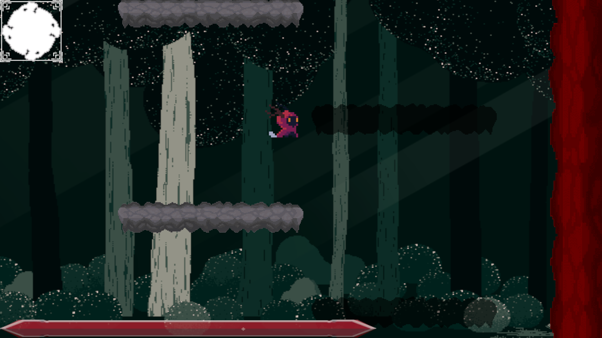

**한눈에 보기**

- **무엇을**: Shift 한 번으로 흰 ↔ 검 속성을 바꿔 지형과 탄환을 통과하는 2D 퍼즐 플랫포머. 스테이지 2개(기믹 7종)와 보스전 1개
- **핵심 설계**: "같은 색이면 실체, 다른 색이면 허상" 규칙을 태그 비교 하나로 구현 · 다른 색 발판은 콜라이더째 꺼서 이동과 레이저가 같은 규칙을 따름 · 보스 패턴은 시작과 정리만 드러내는 `IBossPattern`
- **결과**: 메뉴부터 보스 격파까지 한 판 완성(07.07) · 보스전 랜덤 발판이 플레이어를 가두는 구조적 원인을 찾아 기능을 걷어냄(07.10) · 자동 테스트 플레이로 주요 동작 17항목 검증, 새 버그 3건 발견(11.09) · 리팩토링에서 되살아난 빌드 에러를 찾아 재수정(11.09)

## 목차

1. [프로젝트 개요](#1-프로젝트-개요)
2. [시스템 구조](#2-시스템-구조)
3. [Shift 속성 시스템](#3-shift-속성-시스템)
4. [스테이지 기믹과 퍼즐](#4-스테이지-기믹과-퍼즐)
5. [보스전](#5-보스전)
6. [기타 구현](#6-기타-구현)
7. [결과 및 배운 점](#7-결과-및-배운-점)

---

## 1. 프로젝트 개요

### 1.1 무엇을 만들었나 (What)

**SHIFTER**는 플레이어(Shifter)가 자신의 속성을 흰색 ↔ 검은색으로 바꿔 가며 스테이지를 통과하는 2D 퍼즐 플랫포머입니다.

- **발판**은 플레이어와 **같은 색일 때만 밟힙니다.** 다른 색 발판은 반투명해지고 몸이 그대로 통과합니다.
- **탄환**도 플레이어와 **같은 색일 때만 맞습니다.** 다른 색 탄환은 몸을 지나갑니다.
- 그래서 Shift를 누르는 순간 '밟을 수 있는 곳'과 '맞는 탄환'이 동시에 뒤집힙니다. 흰 발판을 밟으려면 흰색이어야 하고, 흰색인 동안에는 흰 탄환을 피해야 합니다. Shift에는 1초 쿨타임이 있어 연타로 모든 상황을 넘길 수는 없습니다.

| 스테이지 | 내용 |
|---|---|
| STAGE 1 | 레드 타일(화상), 흰·검 총알 발사기, 박스 운반 퍼즐, 전구 퍼즐 |
| STAGE 2 | 이동 발판, 레이저 반사 퍼즐, 밀려오는 흰·검 벽(크러셔 벽) |
| STAGE BOSS | 보스 **AGIS - RED MARTYR**. 패턴 3번 뒤 5초 그로기, 그동안 약점을 위에서 밟아 3번 맞히면 격파 |

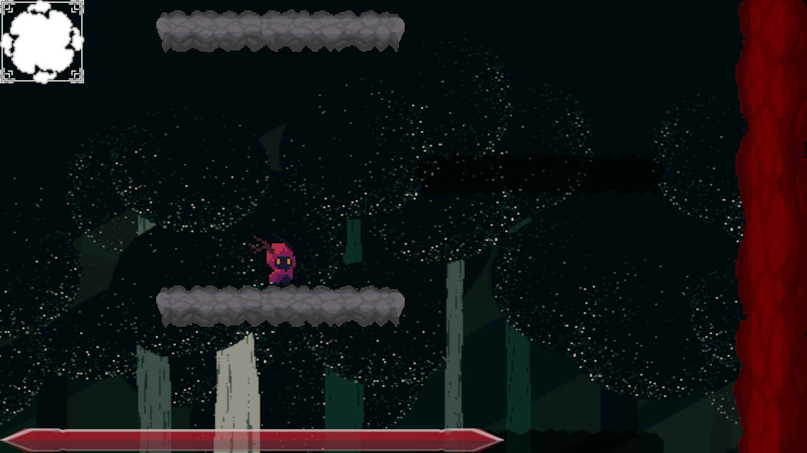

*인게임 화면(STAGE 2, 흰색 상태). 왼쪽 위에 현재 속성 표시, 아래에 HP 바가 고정되어 있습니다. 플레이어가 선 회색 돌 발판이 흰 발판이고, 오른쪽에 반투명하게 보이는 어두운 발판은 지금 색으로는 밟을 수 없는 검은 발판입니다.*

이 문서는 게임을 이루는 시스템 중 아래 **세 가지**의 설계·구현과 선택의 이유를 다룹니다.

| 핵심 기능 | 한 줄 요약 | 장 |
|---|---|---|
| Shift 속성 시스템 | 플레이어·발판·탄환이 같은 태그 문자열을 갖고, 모든 판정이 "같은 색인가" 하나로 끝난다 | 3 |
| 스테이지 기믹과 퍼즐 | 버튼은 UnityEvent로 잇고, 레이저 반사와 밀어내는 벽을 키네마틱 이동 위에 직접 구현한다 | 4 |
| 보스전 | 패턴 3종을 `IBossPattern`(시작·정리)으로 통일하고, 패턴 3회 → 그로기 → 약점의 주기를 돈다 | 5 |

### 1.2 왜 이렇게 만들었나 (Why)

이 게임의 재미는 **Shift 한 번에 '밟을 수 있는 곳'과 '맞는 탄환'이 동시에 뒤집히는 데** 있습니다. 이 규칙을 약 2주 안에 스테이지 2개와 보스전에 걸쳐 구현하면서 부딪힌 문제는 세 가지였습니다.

| 문제 | 구체적 상황 | 해결 방향 |
|---|---|---|
| 키 하나가 여러 대상을 동시에 바꾼다 | Shift 한 번에 발판(씬당 흰·검 최대 20개)의 충돌과 투명도, 탄환 피격, 속성 UI가 같은 규칙으로 바뀌어야 한다. 대상마다 판정을 따로 두면 규칙이 서로 어긋난다 | 속성을 태그 하나로 통일하고 "같은 색인가"만 묻는다 (3장) |
| 기믹마다 입력이 다르고, 이동은 물리 엔진 밖에 있다 | 박스 밀기·전구 토글·레이저 조준·밀려오는 벽은 입력과 판정이 모두 다르다. 플레이어는 키네마틱 BoxCast로 움직여, 밀고 밀리는 상호작용이 자동으로 생기지 않는다 | 버튼은 UnityEvent로 잇고, 플레이어를 옮기는 길은 `CharacterController2D` 하나로 (4장) |
| 패턴이 바뀌어도 화면이 깨끗해야 한다 | 보스 패턴 3종이 10초마다 무작위로 바뀌고 3회 뒤 그로기로 넘어간다. 난사 패턴 하나가 탄을 40발 만들고, 남은 탄이 다음 패턴이나 그로기에 섞이면 안 된다 | 패턴이 시작과 정리를 스스로 책임지는 인터페이스 (5장) |

목표는 **7월 초까지 메뉴 → STAGE 1 → STAGE 2 → 보스 격파로 이어지는 한 판을 완성하고, 모든 기믹을 Shift 규칙 하나로 설명할 수 있게 만드는 것**이었습니다.

### 1.3 개발 환경

| 항목 | 내용 |
|---|---|
| 엔진 | Unity 6 (6000.3.15f1), URP 2D |
| 언어 | C# |
| 주요 패키지 | Input System, uGUI + TextMeshPro |
| 공용 유틸리티 | `CharacterController2D`(키네마틱 2D 이동), `SimpleInput`(Input System 래퍼): 강의 저장소의 `Study.Utilities` 코드. `CharacterController2D`에는 박스 밀기를 직접 추가 ([6.2](#62-박스-밀기-공용-유틸리티에-추가한-부분)) |
| 외부 에셋 | 플레이어·보스·타일·배경·UI 스프라이트와 Super Pixel Projectiles Pack 1(보스 탄환). 모두 구매하거나 무료로 배포된 에셋을 사용 |
| 도구 | JetBrains Rider, Git / GitHub |
| 기간 | 2026.06.24 ~ 2026.07.10 (07.07 완성, 07.10 리팩토링) · 2026.11.09 문서화 검수 (자동 테스트 플레이, 빌드 에러 재수정) |
| 인원 | 1인 |
| 규모 | C# 스크립트 33개(약 1,900줄, 공용 유틸리티 제외), 씬 4개 |

### 1.4 링크

- GitHub: https://github.com/rlawlsdn77/Unity-2D-Shifter
- 시연 영상: (링크 첨부 예정)

### 1.5 핵심 루프

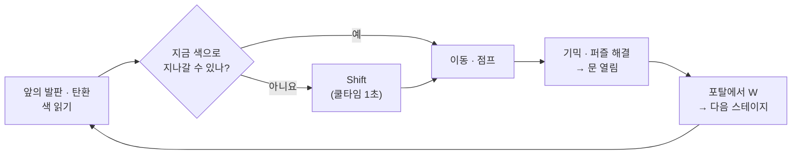

스테이지 안에서 플레이어는 "지금 색으로 저 발판을 밟을 수 있나", "저 탄은 내 색인가"를 계속 판단합니다. 쿨타임 1초 때문에 **언제 바꿀지**도 함께 골라야 합니다. 보스전에서는 같은 판단을 탄막 속에서 반복하다가, 그로기 5초 안에 약점을 밟습니다.

### 1.6 조작법

| 입력 | 동작 |
|---|---|
| A · D / ← · → | 좌우 이동 (초당 8유닛) |
| Space | 점프. 공중에서 한 번 더 (2단 점프) |
| Shift (왼쪽 · 오른쪽) | 속성 전환. 시작은 회색(Common), 이후 흰 ↔ 검 (쿨타임 1초) |
| W / ↑ | 포탈 안에서 다음 스테이지로 |
| Esc | 일시정지 · 해제 |
| 마우스 | 레이저 퍼즐 조준 모드에서 빛의 방향 |

### 1.7 레퍼런스

| 게임 | 참고한 점 | 이 프로젝트에서 다른 점 |
|---|---|---|
| Outland | 색(빛·어둠)을 바꿔 같은 공간의 지형과 탄막을 다르게 통과하는 2D 플랫포머 | Outland는 같은 색 탄환이 무해하지만, 이 게임은 반대로 **같은 색 탄환에 맞는다.** 같은 색이어야 밟히는 발판과 맞물려, 한 색을 고르면 그 색의 발판과 탄환을 함께 떠안는다. 전환에는 1초 쿨타임이 있다 |

---

## 2. 시스템 구조

### 2.1 씬 구성과 흐름

| 씬 | 역할 | 주요 구성 |
|---|---|---|
| Menu | 시작, 조작법(HOW TO PLAY), 종료 | `SceneChanger` |
| STAGE 1 | 기초 기믹. 흰 발판 4 · 검 발판 3 · 레드 타일 5 | `BulletLauncher` ×4, `BoxGoal`, `ButtontoLight` ×5 · `ButtonReset` |
| STAGE 2 | 응용 기믹. 흰 발판 9 · 검 발판 11 · 레드 타일 3 | `MovingPlatform` ×3, `LaserPuzzleManager` · `LightBeam` · `Mirror` ×3 · `LightSensor`, `CrusherWall` |
| STAGE BOSS | 보스전. 검 발판 1 · 레드 타일 6 | `BossManager` · 패턴 3종, `BossHeart`, `OnBosspattern`, 보스 UI |

세 스테이지 씬에는 공통으로 플레이어(`Shifter` 프리팹), UI 프리팹(HP·속성·일시정지·게임오버·보스 UI), `PlatformManager`, `CameraController`, `Red`, 포탈이 있습니다.

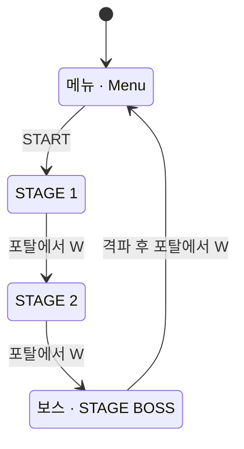

- 포탈은 '다음 빌드 인덱스'로 이동하고 마지막 씬 다음은 0번(메뉴)이라, 보스방 포탈은 메뉴로 돌아갑니다.
- 어느 스테이지든 HP가 0이 되면 게임오버 화면(RESTART: 지금 스테이지 처음부터 / MENU: 메뉴)이 뜨고 시간이 멈춥니다. Esc는 일시정지 화면(RESTART / MENU)을 엽니다.
- 스테이지 사이에 이어지는 값은 없습니다. 씬을 열 때마다 HP 100, 속성 회색(Common)에서 시작합니다.

| 메뉴 | 게임오버 | 일시정지 |
|---|---|---|
| 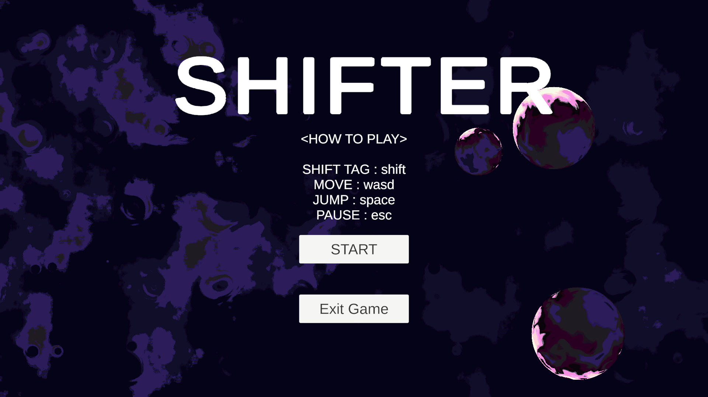 | 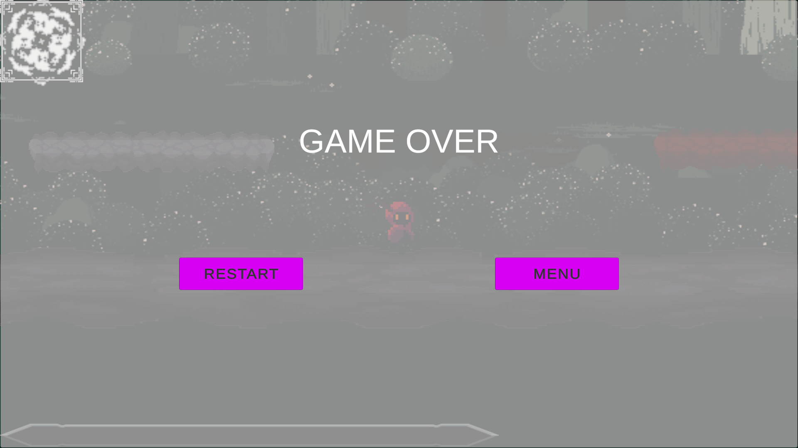 | 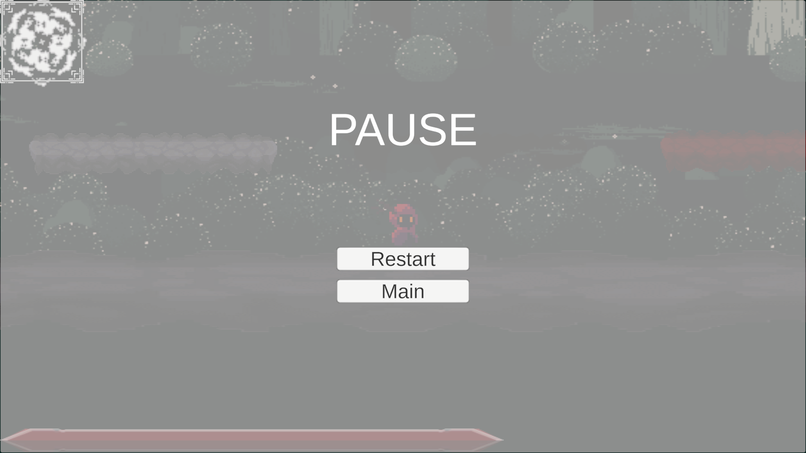 |

### 2.2 아키텍처

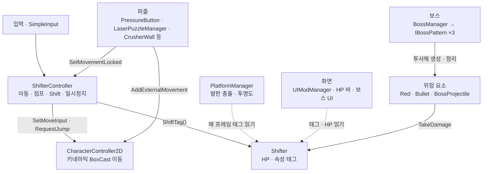

> 실선은 직접 호출, 점선은 값을 읽기만 하는 관계입니다. 플레이어의 속성(태그)을 **바꾸는** 곳은 `Shifter.ShiftTag()` 하나이고, 나머지는 모두 읽기만 합니다. 클래스 단위의 흐름은 4.1, 5.1의 다이어그램에서 다룹니다.

### 2.3 설계 규칙

구조 전체를 관통하는 규칙은 네 가지입니다. 각 장의 '고민과 선택'에서 이 규칙을 왜 정했는지 설명합니다.

1. **속성은 태그 하나로 표현한다.** 플레이어·발판·탄환이 같은 문자열(`Common`/`White`/`Black`)을 태그로 갖고, 판정은 `CompareTag`로 "같은 색인가"만 묻는다. 속성을 바꾸는 곳은 `Shifter.ShiftTag()` 하나뿐이다. → [3장](#3-shift-속성-시스템)
2. **같은 색이면 실체, 다른 색이면 허상.** 발판은 같은 색일 때 밟히고, 탄환은 같은 색일 때 맞는다. STAGE 2의 크러셔 벽만 의도적으로 반대다. → [3.1](#31-문제와-구조)
3. **플레이어를 옮기는 길은 `CharacterController2D` 하나.** 플레이어는 물리 엔진에 밀리지 않는다. 입력은 `SetMoveInput`, 외부에서 미는 양은 `AddExternalMovement`로만 넣고, 실제 이동은 모두 BoxCast 검사를 거친다. → [4.4](#44-고민과-선택)
4. **패턴은 자기가 만든 것을 스스로 치운다.** 보스 패턴은 `StartPattern`/`EndPattern`만 드러내고, `EndPattern`에서 자기 코루틴과 투사체를 모두 정리한다. → [5장](#5-보스전)

### 2.4 핵심 클래스 역할

| 계층 | 클래스 | 책임 | 하지 않는 일 |
|---|---|---|---|
| 플레이어 | `ShifterController` | 입력 → 이동·점프, Shift 쿨타임, 일시정지, 조준 중 이동 잠금 | 속성 규칙, HP |
| 플레이어 | `Shifter` | HP(0~100)와 HP 바, 속성 태그 전환, 피격 점멸, 사망 처리 | 입력 읽기 |
| 플레이어 | `CharacterController2D` (공용) | 키네마틱 BoxCast 이동, 중력·2단 점프, 외부 이동량, 박스 밀기 | 입력 읽기 |
| 속성 | `PlatformManager` | 태그로 발판을 모아 충돌·투명도를 플레이어 색에 맞춘다 | 플레이어 이동 |
| 속성 | `BossAttributeUtil` | 태그 상수, 태그 → 색 변환, 무작위 태그, 태그·색 함께 입히기 | 판정 |
| 속성 | `UIModManager` | 속성이 바뀐 프레임에만 속성 UI 교체 | |
| 기믹 | `Red` | 자식 레드 타일에 닿아 있는 동안 일정 간격으로 피해 | 색 판정 (색과 무관) |
| 기믹 | `BulletLauncher` · `Bullet` | 일정 간격으로 흰/검 총알 발사 · 같은 색 대상에 피해 | |
| 퍼즐 | `PressureButton` | 플레이어가 밟으면 인스펙터에 연결된 `UnityEvent` 호출 | 무엇을 할지 알기 |
| 퍼즐 | `LaserPuzzleManager` | 조준 모드 진입·해제 (카메라 전환, 이동 잠금) | 빛 계산 |
| 퍼즐 | `LightBeam` · `Mirror` · `LightSensor` | 마우스 방향 레이캐스트와 거울 반사 · 반사면 표시 · 맞으면 문을 영구히 연다 | |
| 퍼즐 | `CrusherWall` | 흰/검 벽 생성·이동, 다른 색이면 플레이어를 민다 | |
| 퍼즐 | `BoxGoal` · `ButtontoLight` · `ButtonReset` | 박스 골인 시 문 열기 · 전구 토글 · 초기화와 정답 검사 | |
| 보스 | `BossManager` | 패턴 교체(10초), 그로기(5초), 사망 연출 | 패턴 내용 |
| 보스 | `IBossPattern` 구현 3종 | 패턴 하나의 공격과 정리 | 다음 패턴 고르기 |
| 보스 | `BossProjectile` · `BossHeart` | 이동·수명(10초)·같은 색 피격 · 위에서 밟히면 보스 체력 −1 | 그로기 시간 |
| 화면 | `OnBosspattern` · `BossHealthUI` · `BossTimerUI` | 보스방 입장 처리 · 보스 체력 · 격파 시간 표시 | |
| 씬 | `SceneChanger` · `Portal` | 버튼으로 씬 이동 · 포탈에서 다음 씬 | |

---

## 3. Shift 속성 시스템

### 3.1 문제와 구조

**문제.** Shift 한 번에 바뀌어야 하는 것이 네 가지입니다. ① 흰·검 발판의 충돌 ② 발판의 투명도 ③ 탄환 피격 ④ 속성 UI. 이 판정을 대상마다 따로 만들면 "같은 색이면 실체"라는 규칙이 대상마다 조금씩 다르게 구현되고, 하나를 바꿀 때 나머지를 함께 고쳐야 합니다.

**구조.** 속성을 Unity 태그 문자열 하나로 통일했습니다. 플레이어의 태그를 바꾸는 곳은 `Shifter.ShiftTag()` 하나이고, 나머지는 모두 "플레이어 태그와 내 태그가 같은가"를 읽기만 합니다.

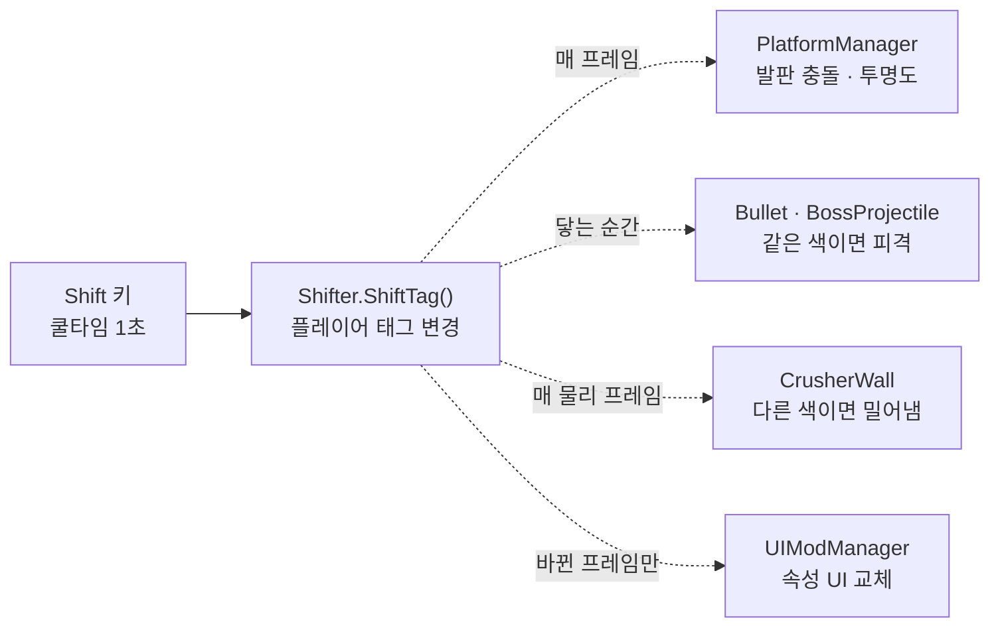

| 대상 | 플레이어와 같은 색 | 다른 색 | 비고 |
|---|---|---|---|
| 흰·검 발판 | 충돌 O · 불투명 | 충돌 X · 반투명(α 0.5) | 회색 상태에서는 흰·검 모두 충돌 X |
| 회색·빨강 발판 (Common · Red) | 항상 충돌 O | 항상 충돌 O | 빨강은 닿아 있는 동안 피해 |
| 탄환 (총알 · 보스 탄) | 맞는다 (피해 후 소멸) | 통과 | 보스 탄은 회색 지형에 닿으면 소멸 |
| 크러셔 벽 (STAGE 2) | 통과 | 밀려남 · 반투명 | 발판과 반대 규칙 (의도한 변주) |
| 속성 UI | 현재 속성 이미지 하나만 표시 | | |

플레이어 속성은 이렇게 바뀝니다.

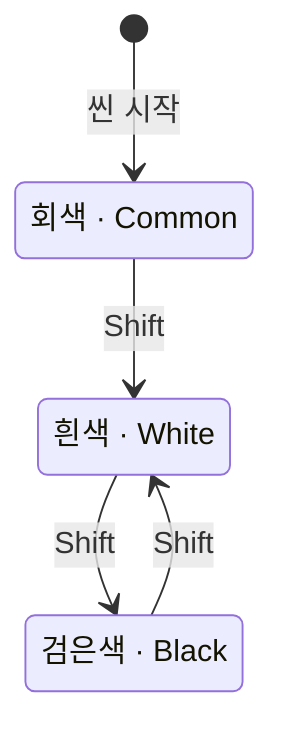

- **회색(Common)은 출발 상태입니다.** 흰·검 발판을 모두 밟을 수 없지만 흰·검 탄환에도 맞지 않습니다. 첫 Shift 뒤에는 흰 ↔ 검만 오가고 회색으로 돌아오지 않습니다. '안전하지만 멀리 갈 수 없는' 상태에서 출발해, 앞으로 나아가려면 색을 골라야 합니다.
- **크러셔 벽은 규칙을 뒤집었습니다.** 발판에서 익힌 "같은 색 = 단단함"과 반대로, 벽은 같은 색일 때 통과하고 다른 색일 때 밀어냅니다. STAGE 2 마지막 구간에서 익숙한 규칙을 거꾸로 쓰게 하는 변주입니다.

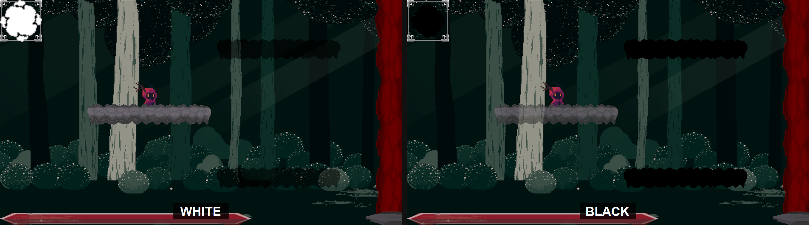

*같은 자리에서 Shift만 눌러 흰색(왼쪽)과 검은색(오른쪽)을 비교한 화면. 흰색일 때는 위·아래 검은 발판이 반투명하고, 검은색이 되면 검은 발판이 진해지는 대신 플레이어가 선 흰 발판이 반투명해집니다. 흰 발판은 회색 돌 모양이라 반투명해져도 차이가 작습니다.*

### 3.2 사용법

속성 규칙을 쓰는 쪽은 **태그만 맞추면** 됩니다. 등록 코드나 이벤트 구독이 없습니다.

| 하고 싶은 일 | 방법 |
|---|---|
| 흰·검 발판 추가 | `white tile` / `black tile` 프리팹을 배치한다. `PlatformManager`가 태그로 찾아 관리하므로 코드 수정이 없다. 조건: `BoxCollider2D` + `SpriteRenderer`가 있고 `Rigidbody2D`는 없으며, Tile 레이어(플레이어 이동 판정 대상)일 것 |
| 투사체에 색 입히기 | `BossAttributeUtil.Apply(obj, tag)`. 태그와 색(흰·검·회색)을 함께 지정한다 |
| 플레이어 속성 읽기 | `shifter.currentTag` 또는 `player.CompareTag(tag)` |
| Shift 쿨타임 조정 | `Shifter` 프리팹의 `ShifterController.shiftCooldown` (현재 1초) |

```csharp
// BossAttributeUtil.cs (발췌) — 태그 문자열을 상수로 모으고, 태그와 색을 한 번에 입힌다
public const string COMMON = "Common";
public const string WHITE = "White";
public const string BLACK = "Black";

// 실제 플레이어가 바꿀 수 있는 속성 (투사체는 이 둘 중 하나)
public static readonly string[] ShiftableTags = { WHITE, BLACK };

public static string RandShiftTag()
{
    return ShiftableTags[Random.Range(0, ShiftableTags.Length)];
}

public static void Apply(GameObject obj, string tag)
{
    obj.tag = tag;
    SpriteRenderer sr = obj.GetComponent<SpriteRenderer>();
    sr.color = GetColor(tag);      // Black → 검정, White → 흰색, 그 외 → 회색
}
```

보스 패턴 3종은 투사체를 만들 때 모두 이 함수로 색을 정합니다.

```csharp
// BossPattern_Razer.cs — 레이저 한 발을 무작위 흰/검 속성으로 초기화
string attributeTag = BossAttributeUtil.RandShiftTag();
laser.GetComponent<BossProjectile>().Initialize(firingDirection, laserSpeed, laserDamage, attributeTag);
```

### 3.3 핵심 동작

**① 전환: 쿨타임을 확인하고 태그를 바꾼다**

```csharp
// ShifterController.cs — 쿨타임이 끝났을 때만 바꾼다 (쿨타임은 입력 쪽이 지킨다)
private void ShiftInput()
{
    if (SimpleInput.GetKeyDown(Key.LeftShift) || SimpleInput.GetKeyDown(Key.RightShift))
    {
        if (cooldownTimer <= 0f)
        {
            cooldownTimer = shiftCooldown;

            animator.SetTrigger(IS_SHIFT);
            shifter.ShiftTag();
        }
    }
}

// Shifter.cs — 흰색이면 검은색, 그 외(회색 포함)는 흰색
public void ShiftTag()
{
    gameObject.tag = (gameObject.CompareTag(TAG_WHITE)) ? TAG_BLACK : TAG_WHITE;
    currentTag = gameObject.tag;
}
```

- 회색에서 Shift하면 `CompareTag(White)`가 거짓이라 흰색이 됩니다. 이후로는 흰 ↔ 검만 오가므로 회색으로 돌아오는 길이 코드에 없습니다.
- 속성을 바꾸는 코드는 이 세 줄이 전부입니다. 발판·탄환·UI는 이 태그를 읽기만 합니다.

**② 발판: 태그로 모으고, 콜라이더째 끈다**

```csharp
// PlatformManager.cs (발췌) — 매 프레임 플레이어 태그를 읽어 발판의 충돌과 투명도를 맞춘다
private static readonly string[] ManagedTags = { "Common", "White", "Black", "Red" };

private void Update()
{
    RefreshTargets();
    ColliderControll();
    AlphaControll();
}

private void RefreshTargets()
{
    allColliders.Clear();
    allSprites.Clear();
    foreach (string tag in ManagedTags)
    {
        GameObject[] objs = GameObject.FindGameObjectsWithTag(tag);
        foreach (GameObject obj in objs)
        {
            if (obj.GetComponent<Rigidbody2D>() != null) continue;   // 움직이는 투사체 등은 발판이 아니다

            BoxCollider2D col = obj.GetComponent<BoxCollider2D>();
            if (col != null) allColliders.Add(col);
            SpriteRenderer sr = obj.GetComponent<SpriteRenderer>();
            if (sr != null) allSprites.Add(sr);
        }
    }
}

private void ColliderControll()
{
    foreach (BoxCollider2D col in allColliders)
    {
        GameObject obj = col.gameObject;
        if (obj.CompareTag("Common") || obj.CompareTag("Red")) col.enabled = true;   // 무색: 항상 단단하다
        else if (obj.CompareTag(player.tag)) col.enabled = true;                     // 같은 색: 단단하다
        else col.enabled = false;                                                     // 다른 색: 없는 것과 같다
    }
}
```

- **무엇을 관리할지는 태그로 정합니다.** `Common`·`White`·`Black`·`Red` 태그를 가진 오브젝트를 모으고, 이동하는 투사체(`Rigidbody2D` 보유)는 건너뜁니다. 매 프레임 다시 찾는 이유는 [3.4 결정 2](#34-고민과-선택)에서 다룹니다.
- **다른 색 발판은 콜라이더 자체를 끕니다.** 그래서 플레이어의 이동 판정(BoxCast)뿐 아니라 레이저 퍼즐의 레이캐스트도 그 발판을 지나갑니다. Shift가 빛의 길까지 바꾸는 이유입니다 ([4.3 ①](#43-핵심-동작)).
- 투명도는 같은 목록을 돌며 '플레이어와 반대 색'인 발판만 α 0.5로 낮춥니다(`AlphaControll`). 회색 상태에서는 반대 색이 없으므로 아무것도 흐려지지 않습니다.

**③ 탄환: 같은 색일 때만 맞는다**

```csharp
// BossProjectile.cs — 같은 색이면 맞고 사라진다. 다른 색이면 지나간다. 회색 지형에는 막힌다
private void OnTriggerEnter2D(Collider2D collision)
{
    if (collision.gameObject.name == "Shifter")
    {
        if (collision.CompareTag(gameObject.tag))
        {
            shifter.TakeDamage(damage);
            Destroy(gameObject);
        }
    }
    else if (collision.CompareTag("Common"))
    {
        Destroy(gameObject);
    }
}
```

- 흰·검 발판은 탄환을 막지 않습니다. 보스 탄을 막는 것은 회색 지형뿐이라, 발판 뒤에 숨는 대신 **색을 바꿔 몸으로 흘려보내는** 것이 핵심 회피 수단입니다.
- STAGE 1의 총알(`Bullet`)도 같은 규칙(`collision.CompareTag(gameObject.tag)`)으로 판정합니다. 다만 총알 프리팹의 콜라이더가 트리거가 아니라, 현재는 이 판정 자체가 불리지 않아 총알에 맞지 않습니다. 테스트로 찾았고 아직 고치지 않았습니다([7.3 ①](#73-아쉬운-점과-향후-계획)).

**④ 속성 UI: 바뀐 프레임에만 교체한다**

```csharp
// UIModManager.cs — 직전 태그를 기억해 두고, 바뀐 프레임에만 UI를 바꾼다
private void Update()
{
    if (player == null) return;
    string currentTag = player.tag;
    if (currentTag != lastTag)
    {
        UpdateUI(currentTag);      // Common · White · Black 이미지 중 하나만 켠다
        lastTag = currentTag;
    }
}
```

같은 '태그 읽기'인데 `PlatformManager`는 매 프레임 전부 다시 쓰고, `UIModManager`는 바뀔 때만 씁니다. 이 차이는 [7.3](#73-아쉬운-점과-향후-계획)에서 개선 과제로 다시 다룹니다.

**예외 상황 처리**

| 상황 | 처리 |
|---|---|
| 쿨타임(1초) 중 Shift 입력 | 무시. `cooldownTimer`가 0 이하일 때만 바꾼다 |
| 씬 시작 직후 (회색 · Common) | 흰·검 발판을 모두 밟을 수 없고, 흰·검 탄환에도 맞지 않는다. 첫 Shift는 항상 흰색 |
| 레이저 조준 중 Shift | 허용. 이동만 잠그고 Shift는 받아, 제자리에서 빛의 길을 바꾼다 ([4.1](#41-문제와-구조)) |
| 흰·검 태그지만 발판이 아닌 오브젝트 (크러셔 벽, 보스 탄) | `Rigidbody2D`가 있으면 `PlatformManager`가 건너뛴다. 크러셔 벽은 이 때문에 `Rigidbody2D`를 붙인다 ([4.3 ②](#43-핵심-동작)) |
| 다른 색 발판 안에서 Shift | **처리 없음.** 켜진 발판 안에 갇히고, 1초 뒤 다시 Shift해야 풀린다 ([7.3 ①](#73-아쉬운-점과-향후-계획)) |

### 3.4 고민과 선택

**결정 1. 속성을 무엇으로 표현할까?**

> **[대안 A] Unity 태그**
> - 장점: `CompareTag` 한 줄로 어디서든 비교한다. `FindGameObjectsWithTag`로 발판을 모을 수 있다. 프리팹마다 인스펙터에서 지정된다(`white tile` = `White`).
> - 단점: 오브젝트당 태그가 하나뿐이다. 플레이어가 속성 태그를 쓰면 `Player` 태그를 쓸 수 없다. 문자열이라 오타가 컴파일 때 잡히지 않는다.
>
> **[대안 B] 속성 enum을 가진 컴포넌트 (`ShiftAttribute` 같은)**
> - 장점: 타입이 안전하고, `Player` 태그를 그대로 쓸 수 있다.
> - 단점: 비교할 때마다 `GetComponent`가 필요하고, 발판을 모으는 방법(등록 목록 등)을 직접 만들어야 한다.
>
> **[대안 C] 레이어 + 플레이어의 충돌 마스크**
> - 장점: 플레이어의 `collisionLayer`만 바꾸면 발판 충돌이 끝난다.
> - 단점: 레이어도 오브젝트당 하나라, 이미 쓰고 있는 Tile 레이어(이동 판정 대상)와 겹친다. 투명도와 탄환 피격은 여전히 따로 처리해야 한다.
>
> **[결정] 대안 A.** 플레이어·발판·탄환이 **같은 문자열 하나**로 비교되는 단순함이 이 게임의 규칙("같은 색인가")과 그대로 맞았습니다. 대가는 플레이어 판별이었습니다. 속성이 태그를 차지해 플레이어를 오브젝트 이름(`"Shifter"`)으로 찾게 됐고, 문자열 오타는 `BossAttributeUtil`의 상수로 일부만 막았습니다. 이 대가는 [7.3](#73-아쉬운-점과-향후-계획)에 개선 과제로 남겼습니다.

**결정 2. 관리할 발판 목록을 어떻게 모을까?**

> **[대안 A] 시작할 때 자식 콜라이더를 한 번 캐싱** (06.25 ~ 07.05의 방식)
> - 장점: 검색 비용이 시작할 때 한 번뿐이다.
> - 단점: `PlatformManager`의 자식이 아닌 발판, 플레이 중에 새로 생기는 발판을 모른다.
>
> **[대안 B] 매 프레임 태그로 다시 검색** (07.06 ~ 현재)
> - 장점: 계층 구조와 무관하고, 플레이 중에 생긴 발판도 다음 프레임부터 관리한다.
> - 단점: 매 프레임 `FindGameObjectsWithTag` 4번(배열 4개 새로 할당)과 오브젝트마다 `GetComponent`가 반복된다. 관리하면 안 되는 오브젝트(투사체)를 걸러 내야 한다.
>
> **[결정] 보스전에 '패턴마다 무작위 색 발판 5개 생성'을 넣으면서(07.06) 대안 B로 바꿨습니다.** 씬당 관리 대상이 30개 이하라 검색 비용보다 '새 발판을 놓치지 않는 것'이 중요했습니다. 그런데 07.10에 이 랜덤 발판을 걷어낸 뒤에도([5.4 결정 2](#54-고민과-선택)) 매 프레임 검색은 남았습니다. 바꾼 이유가 사라졌으니 되돌리거나 Shift 순간에만 갱신하는 것이 맞습니다([7.3](#73-아쉬운-점과-향후-계획)).

**결정 3. 다른 색 발판을 어떻게 '없는 것'으로 만들까?**

> **[대안 A] 발판의 `BoxCollider2D.enabled`를 끈다**
> - 장점: 플레이어 이동(BoxCast)뿐 아니라 레이캐스트를 쓰는 모든 시스템에서 그 발판이 사라진다. "그 색의 세계에서는 없다"는 규칙이 어디에나 똑같이 적용된다.
> - 단점: 발판 수만큼 켜고 꺼야 하고, 콜라이더가 꼭 필요한 오브젝트(투사체, 크러셔 벽)는 관리 대상에서 빼야 한다.
>
> **[대안 B] 플레이어 쪽 `collisionLayer`(BoxCast 마스크)만 바꾼다**
> - 장점: 발판을 건드리지 않고 플레이어 값 하나만 바꾼다.
> - 단점: 플레이어 이동에만 적용된다. 다른 시스템은 여전히 다른 색 발판에 막히므로, 같은 규칙을 시스템마다 다시 구현해야 한다.
>
> **[결정] 대안 A.** 첫 구현(06.25)부터 콜라이더를 껐습니다. 돌아보면 이 선택 덕분에, 2주 뒤에 만든 레이저 퍼즐(07.07)이 **추가 코드 없이** Shift 규칙을 따랐습니다. 다른 색 발판에서는 빛도 지나가므로, 조준 중에 Shift해 빛의 길을 여닫는 기믹이 저절로 생겼습니다. 대안 B였다면 레이저에 같은 규칙을 한 번 더 구현해야 했습니다. 대가도 함께 왔습니다. 규칙이 레이저에 '저절로' 적용되다 보니, 흰색이 되면 검은 발판이 꺼져 거울 없이 직선 한 번으로 풀리는 지름길까지 생겼습니다([7.3 ①](#73-아쉬운-점과-향후-계획)). 규칙을 모든 시스템에 공유하면 레벨을 배치할 때 그 규칙이 만드는 경로까지 함께 검사해야 합니다.

---

## 4. 스테이지 기믹과 퍼즐

### 4.1 문제와 구조

**문제.**

- 스테이지마다 Shift를 다르게 쓰게 하는 기믹이 필요합니다. 피해야 하는 것(레드 타일, 총알), 풀어야 하는 것(박스, 전구, 레이저), 버텨야 하는 것(크러셔 벽)이 섞여 있습니다.
- 퍼즐의 결과는 대부분 '문 열기'로 같지만, 입력은 밟기·밀기·조준으로 모두 다릅니다.
- 플레이어는 키네마틱 BoxCast로 움직이므로 물리 엔진의 '밀고 밀리는' 상호작용이 자동으로 생기지 않습니다. 박스를 미는 것도, 벽에 밀리는 것도 직접 만들어야 합니다.

**구조.**

| 스테이지 | 기믹 | 동작 | Shift와의 관계 | 클래스 |
|---|---|---|---|---|
| 1 · 2 · 보스 | 레드 타일 | 닿아 있는 동안 0.5초마다 HP −5 (보스방은 1초마다 −10). 현재 STAGE 2의 레드 타일은 판정 설정 누락으로 피해가 없다 ([7.3 ①](#73-아쉬운-점과-향후-계획)) | 색과 무관하게 항상 단단하고 항상 아프다 | `Red` |
| 1 | 총알 발사기 ×4 | 1초마다 아래에서 위로 흰/검 무작위 총알 (피해 5, 속도 7.5). 현재는 판정 버그로 맞지 않는다 ([7.3 ①](#73-아쉬운-점과-향후-계획)) | 총알과 다른 색이면 통과 | `BulletLauncher`, `Bullet` |
| 1 | 박스 운반 | 박스를 밀어 골 지점에 넣으면 문 1이 열린다 | — | `BoxGoal` |
| 1 | 전구 퍼즐 | 버튼 5개가 각자 이웃 전구를 토글하고, 전구 5개가 모두 초록이면 문 2가 열린다 | — | `ButtontoLight`, `ButtonReset` |
| 2 | 이동 발판 ×3 | 위아래 ±2유닛 왕복 | — | `MovingPlatform` |
| 2 | 레이저 반사 | 버튼을 밟으면 조준 모드. 마우스로 빛을 쏴 거울 3개로 반사해 센서에 맞히면 문이 열린다 | Shift로 흰·검 발판을 켜고 꺼 빛의 길을 바꾼다 | `PressureButton`, `LaserPuzzleManager`, `LightBeam`, `Mirror`, `LightSensor` |
| 2 | 크러셔 벽 | 1.2초마다 흰/검 벽이 초당 10유닛으로 밀려온다. 바닥은 레드 타일 | 같은 색이면 통과, 다른 색이면 벽에 걸려 끝 지점까지 끌려간다 (테스트에서 약 60유닛) | `CrusherWall` |

| 박스 운반 | 전구 퍼즐 |
|---|---|
| 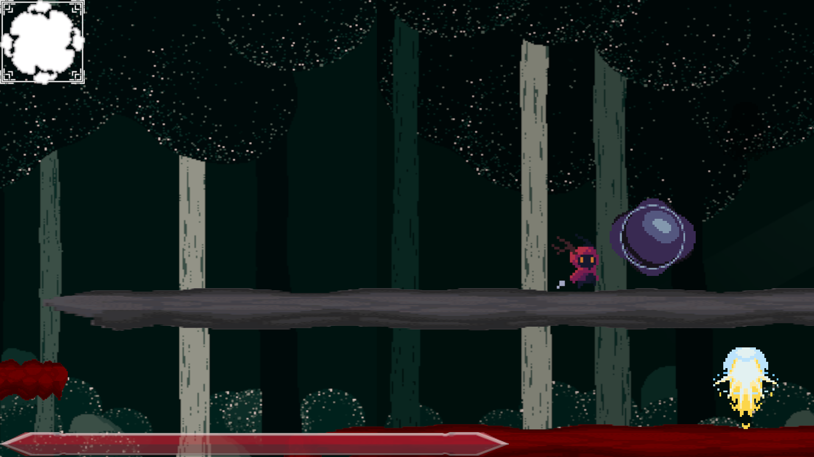 | 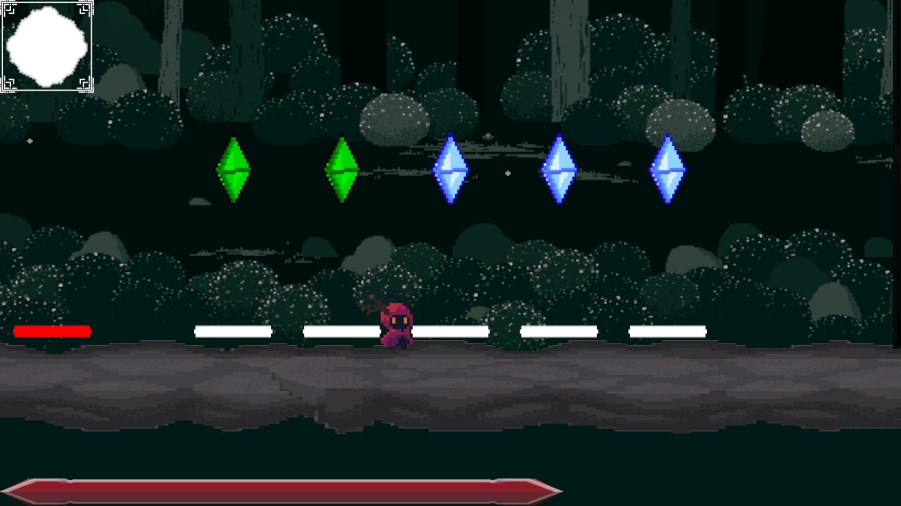 |

*STAGE 1. 박스를 밀며 달리는 중이고(골 지점은 약 60유닛 오른쪽), 아래에서 흰 총알이 올라옵니다. 오른쪽은 전구 일부가 초록으로 바뀐 전구 퍼즐입니다.*

| 레이저 조준 모드 | 크러셔 벽 |
|---|---|
| 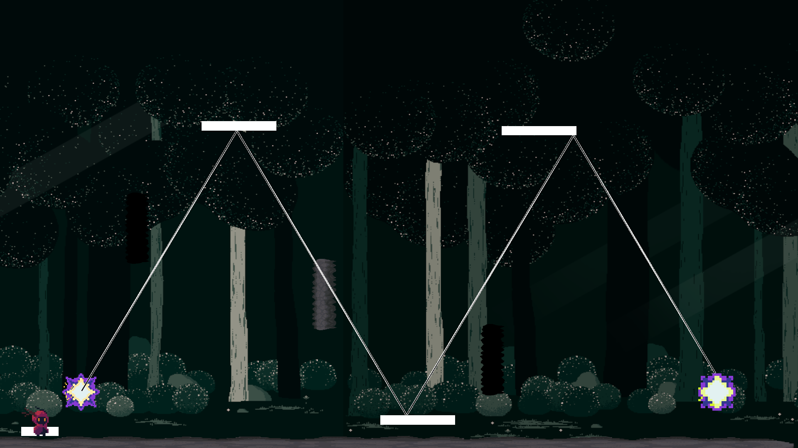 | 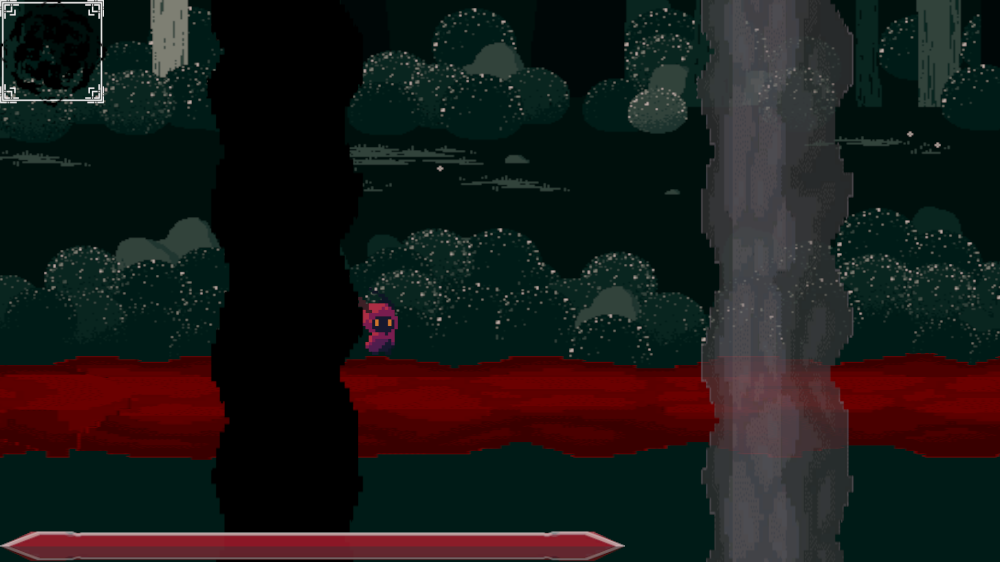 |

*STAGE 2 (둘 다 검은색 상태). 레이저는 흰 막대 거울 3개에서 꺾여 오른쪽 센서에 닿고, 가운데 회색 기둥(흰 발판)은 반투명해져 빛이 그대로 지나갑니다. 크러셔 벽은 같은 색인 검은 벽은 몸을 지나가고, 다른 색인 흰 벽은 반투명하게 다가와 플레이어를 밀어냅니다.*

레이저 퍼즐은 버튼 하나에서 시작해 여러 클래스를 거칩니다.

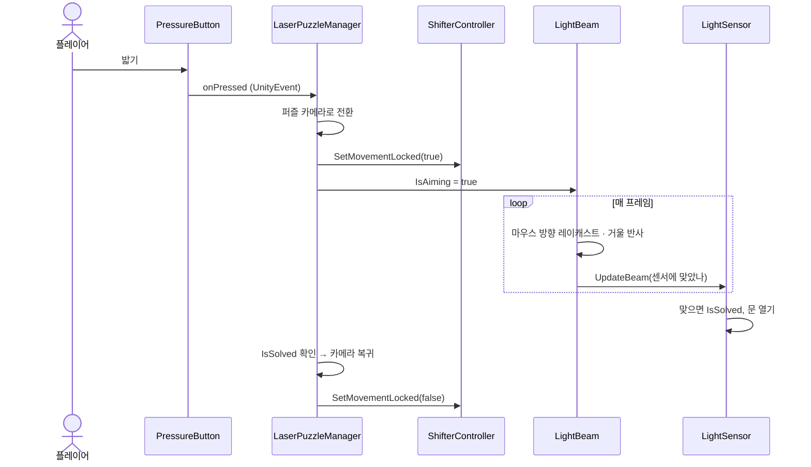

> 조준 중에는 이동만 잠그고 Shift는 허용합니다. 플레이어가 제자리에서 색을 바꿔 빛이 지나갈 발판을 고르게 하기 위해서입니다.

### 4.2 사용법

**새 퍼즐을 버튼에 잇기.** `PressureButton`은 무엇을 할지 모르고 `onPressed`만 부릅니다. 인스펙터에서 함수를 연결하면 버튼 코드를 고치지 않고 새 퍼즐을 붙일 수 있습니다.

```csharp
// PressureButton.cs — 플레이어가 밟으면 인스펙터에 연결된 함수를 부른다
public class PressureButton : MonoBehaviour
{
    [SerializeField] private UnityEvent onPressed;

    private void OnTriggerEnter2D(Collider2D collision)
    {
        if (collision.gameObject.name != "Shifter") return;
        onPressed.Invoke();
    }
}
```

STAGE 2에서는 `onPressed`에 `LaserPuzzleManager.EnterAimMode`가 연결되어 있습니다.

**거울 추가하기.** 콜라이더가 있는 오브젝트에 빈 컴포넌트 `Mirror`를 붙이면 반사면이 됩니다. 반사각은 맞은 면의 법선으로 계산하므로 거울마다 설정할 값이 없습니다.

| 바꾸고 싶은 것 | 고칠 곳 |
|---|---|
| 레이저 사거리(구간당), 최대 반사 횟수 | `LightBeam.maxDistance`(40), `maxBounces`(6) |
| 크러셔 벽 속도 · 생성 간격 | `CrusherWall.moveSpeed`(10), `spawnInterval`(1.2) |
| 레드 타일 피해 | 씬마다 `Red.damageInterval` · `damageAmount` |
| 총알 | `BulletLauncher.fireRate` · `bulletDamage` · `bulletSpeed`. 사거리는 `firePivot` → `endPivot` 거리 |
| 이동 발판 | `MovingPlatform.moveDirection` · `moveDistance` · `moveSpeed` |

### 4.3 핵심 동작

**① 레이저 반사: 레이캐스트를 이어 붙인다**

```csharp
// LightBeam.cs — 조준 중 매 프레임 호출. 맞은 곳까지 선을 긋고, 거울이면 꺾어서 다시 쏜다
private void FireBeam()
{
    Vector2 direction = GetAimDirection();                          // 이미터 → 마우스 방향
    Vector2 origin = (Vector2)transform.position + direction * 0.05f;
    int segmentIndex = 0;
    int bounces = 0;
    int safety = 0;
    bool hitSensorThisFrame = false;

    while (bounces < maxBounces && safety < maxBounces + 5)        // (1) 반사 6회 · 반복 11회 상한
    {
        safety++;
        RaycastHit2D hit = Physics2D.Raycast(origin, direction, maxDistance);
        if (hit.collider == null)
        {
            DrawSegment(segmentIndex++, origin, origin + direction * maxDistance);
            break;
        }
        DrawSegment(segmentIndex++, origin, hit.point);

        if (hit.collider.gameObject.name == "Shifter")             // (2) 플레이어 몸은 빛을 막지 않는다
        {
            origin = hit.point + direction * 0.05f;
            continue;
        }
        if (hit.collider.GetComponent<Mirror>() != null)           // (3) 거울: 입사각 = 반사각
        {
            direction = Vector2.Reflect(direction, hit.normal);
            origin = hit.point + direction * 0.05f;
            bounces++;
            continue;
        }
        if (hit.collider.GetComponent<LightSensor>() != null)
        {
            hitSensorThisFrame = true;
            break;
        }
        if (hit.collider.isTrigger)                                 // 버튼 같은 트리거도 통과
        {
            origin = hit.point + direction * 0.05f;
            continue;
        }
        break;                                                      // 그 밖의 벽·발판에서 멈춘다
    }

    HideUnusedSegments(segmentIndex);                               // (4) 이번에 안 쓴 선은 끈다
    if (targetSensor != null) targetSensor.UpdateBeam(hitSensorThisFrame);
}
```

1. **두 가지 상한.** `bounces`는 거울 반사만 셉니다. 플레이어·트리거를 통과할 때는 늘지 않으므로, 이것만으로는 반복이 끝난다는 보장이 없습니다. 그래서 모든 반복을 세는 `safety`를 따로 둡니다.
2. **다시 쏠 때는 0.05 앞에서.** 맞은 점에서 그대로 다시 쏘면 방금 맞은 면을 또 맞힙니다. 진행 방향으로 조금 띄워 출발합니다.
3. **반사는 법선 하나로.** `Vector2.Reflect(입사 방향, 면의 법선)`이라 거울 각도를 따로 저장하지 않습니다. 거울을 회전시키면 반사각도 따라 바뀝니다.
4. **선은 구간마다 하나, 재사용.** `LineRenderer`를 구간 수만큼만 만들어 두고 다음 프레임에 다시 씁니다. 반사가 줄어 남는 선은 끕니다.
5. **다른 색 발판은 콜라이더가 꺼져 있으므로** 레이캐스트에 맞지 않습니다. 그래서 Shift가 빛의 길을 바꿉니다 ([3.4 결정 3](#34-고민과-선택)).

**② 크러셔 벽: 콜라이더 없이 민다**

```csharp
// CrusherWall.cs (발췌) — 물리 프레임마다 벽을 옮기고, 다른 색 벽이 플레이어와 겹치면 벽이 움직인 만큼 함께 민다
private void FixedUpdate()
{
    spawnTimer -= Time.fixedDeltaTime;
    if (spawnTimer <= 0f)
    {
        SpawnWall();
        spawnTimer = spawnInterval;
    }

    for (int i = walls.Count - 1; i >= 0; i--)                     // 뒤에서부터 돌아야 지우면서 순회할 수 있다
    {
        Wall wall = walls[i];

        bool blocked = !player.CompareTag(wall.obj.tag);            // 다른 색이면 막힌다
        Color color = wall.renderer.color;
        color.a = blocked ? 0.5f : 1f;
        wall.renderer.color = color;

        Vector3 beforeMove = wall.obj.transform.position;
        wall.obj.transform.position = Vector3.MoveTowards(beforeMove, pivot.position, moveSpeed * Time.fixedDeltaTime);
        Vector3 wallDelta = wall.obj.transform.position - beforeMove;

        if (blocked && wall.renderer.bounds.Intersects(playerCollider.bounds))
        {
            playerController.SetMoveInput(0f);
            playerController.AddExternalMovement(wallDelta);        // 벽이 움직인 만큼 플레이어도 움직인다
        }

        if (Vector3.Distance(wall.obj.transform.position, pivot.position) < 0.05f)
        {
            Destroy(wall.obj);
            walls.RemoveAt(i);
        }
    }
}

private void SpawnWall()
{
    GameObject prefab = (Random.value < 0.5f) ? whiteTilePrefab : blackTilePrefab;
    GameObject obj = Instantiate(prefab, transform.position, Quaternion.Euler(0f, 0f, 90f));   // 가로 발판을 세워 벽으로

    BoxCollider2D col = obj.GetComponent<BoxCollider2D>();
    col.enabled = false;                                            // 켜 두면 플레이어가 벽 속에서 얼어붙는다

    Rigidbody2D rb = obj.AddComponent<Rigidbody2D>();               // PlatformManager 관리 대상에서 빼기 위한 표시
    rb.bodyType = RigidbodyType2D.Kinematic;
    rb.gravityScale = 0f;

    walls.Add(new Wall { obj = obj, renderer = obj.GetComponent<SpriteRenderer>() });
}
```

- **콜라이더를 끄는 이유.** 플레이어 이동은 Tile 레이어를 향한 BoxCast로 판정합니다. 벽 콜라이더가 켜진 채 플레이어와 겹치면 BoxCast가 출발 지점부터 막혀 플레이어가 벽 속에 얼어붙습니다. 그래서 벽과 플레이어의 겹침(bounds)을 직접 검사하고, 벽이 움직인 만큼(`wallDelta`)을 `AddExternalMovement`로 더합니다. 이 이동량도 다음 물리 프레임에 BoxCast 검사를 거치므로, 밀려난 플레이어가 다른 지형을 뚫지는 않습니다.
- **`Rigidbody2D`를 붙이는 이유.** 벽은 흰·검 태그 프리팹을 재사용하므로, 그대로 두면 `PlatformManager`가 태그를 보고 콜라이더를 다시 켭니다. `PlatformManager`가 `Rigidbody2D`를 가진 오브젝트를 건너뛰는 점을 이용해 관리 대상에서 뺐습니다.
- **수치의 관계.** 벽(초당 10)이 플레이어(초당 8)보다 빨라 다른 색 벽에서 달아날 수 없습니다. 대신 Shift 쿨타임(1초)이 벽 간격(1.2초)보다 짧아, 벽이 올 때마다 색을 맞출 수 있습니다.

**③ 전구 퍼즐: 이웃을 토글한다**

| 버튼 | 1 | 2 | 3 | 4 | 5 |
|---|---|---|---|---|---|
| 토글하는 전구 | 1 · 2 | 1 · 2 · 3 | 2 · 3 · 4 | 3 · 4 · 5 | 4 · 5 |

```csharp
// ButtontoLight.cs — 밟을 때마다 이 버튼에 연결된 전구를 토글한다 (초록 ↔ 흰색)
private void OnTriggerEnter2D(Collider2D collision)
{
    for (int i = 0; i < LightColor.Length; i++)
    {
        if (LightColor[i] == null) continue;
        LightColor[i].color = (LightColor[i].color == Color.green) ? Color.white : Color.green;
    }
}

// ButtonReset.cs — 문이 닫혀 있는 동안 '모두 초록인가'를 센다. 리셋 버튼을 밟으면 전부 흰색으로
private void CheckAllGreen()
{
    int countGreen = 0;
    for (int i = 0; i < LightColor.Length; i++)
    {
        if (LightColor[i].color == Color.green) countGreen++;
    }
    if (AllGreen == countGreen) Door2.SetActive(false);
}
```

토글은 두 번 누르면 원래대로 돌아오므로, 결과를 정하는 것은 **누른 순서가 아니라 어떤 버튼을 홀수 번 눌렀는가**입니다. 각 버튼이 이웃 전구까지 바꾸기 때문에 하나씩 맞춰 나가면 이미 켠 전구가 다시 꺼집니다. 5개를 모두 켜는 조합은 {1, 4}와 {2, 5} 두 가지뿐이고, 꼬였을 때는 리셋 버튼으로 처음부터 다시 시작합니다.

**예외 상황 처리**

| 상황 | 처리 |
|---|---|
| 이미 풀린 레이저 퍼즐의 버튼을 다시 밟음 | 무시 (`isAiming` 또는 `IsSolved`) |
| 빛이 센서에서 벗어남 | 한 번 맞으면 `IsSolved`가 유지되어 문은 계속 열려 있다 |
| 조준 중 이동 입력 | `SetMovementLocked`로 막고 이동 애니메이션 값을 0으로. Shift는 허용 |
| 반사가 끝없이 이어짐 | 반사 6회 · 반복 11회에서 끊는다 |
| 크러셔 벽이 목표 지점에 도착 | 0.05 이내면 파괴하고 목록에서 뺀다 (뒤에서부터 순회) |
| 전구 퍼즐이 꼬임 | 리셋 버튼으로 전구 5개를 모두 흰색으로 |

### 4.4 고민과 선택

**결정 1. 크러셔 벽과 플레이어의 충돌을 어떻게 처리할까?**

> **[대안 A] 벽 콜라이더를 켜고 이동 판정에 맡긴다**
> - 장점: 추가 코드가 없다. 플레이어가 벽을 향해 걸으면 BoxCast가 막는다.
> - 단점: 벽이 플레이어 쪽으로 움직여 겹치는 순간, BoxCast가 겹친 상태에서 출발해 모든 방향이 막힌다. 키네마틱 이동에는 겹침을 풀어 주는 처리가 없어 플레이어가 벽 속에 얼어붙는다.
>
> **[대안 B] 벽을 Dynamic 물체로 두고 물리로 민다**
> - 장점: 밀어내기를 물리 엔진이 한다.
> - 단점: 키네마틱인 플레이어는 물리 힘을 받지 않는다. 결국 플레이어 위치는 직접 옮겨야 한다.
>
> **[대안 C] 벽 콜라이더를 끄고, 겹침을 직접 검사해 벽 이동량을 플레이어에게 더한다**
> - 장점: 이동 판정과 부딪히지 않는다. 미는 양도 `CharacterController2D`를 거쳐 다른 지형에 대한 BoxCast 검사를 받는다.
> - 단점: 겹침 판정이 스프라이트 사각형 기준이라 모양이 단순한 벽에만 맞는다. `PlatformManager`가 콜라이더를 다시 켜지 않도록 `Rigidbody2D`를 붙이는 우회가 필요하다.
>
> **[결정] 대안 C.** 이동 판정을 BoxCast가 쥐고 있는 구조에서는 **플레이어를 옮기는 길을 `CharacterController2D` 하나로 모으는 것**이 가장 안전하다고 판단했습니다(설계 규칙 3). 대가인 `Rigidbody2D` 우회는 "`Rigidbody2D`가 있으면 `PlatformManager` 관리 대상이 아니다"라는 암묵 규칙에 기댄 것이라, [7.3](#73-아쉬운-점과-향후-계획)에 개선 과제로 남겼습니다.

**결정 2. 레이저 경로를 어떻게 계산할까?**

> **[대안 A] 빛 입자(투사체)를 쏘고 물리 반사에 맡긴다**
> - 장점: 반사 계산을 직접 하지 않는다.
> - 단점: 경로가 한 번에 보이지 않는다. 조준을 바꿀 때마다 다시 날아가야 하고, 속도와 충돌 정밀도에 따라 결과가 흔들린다.
>
> **[대안 B] 매 프레임 레이캐스트를 이어 붙인다**
> - 장점: 마우스를 움직이는 즉시 전체 경로가 보인다. 같은 조준이면 항상 같은 경로다. 반사 횟수를 정확히 제한할 수 있다.
> - 단점: 반사·통과 규칙(거울, 플레이어, 트리거)을 직접 구현해야 하고, 같은 면을 다시 맞히는 문제와 무한 반복을 직접 막아야 한다.
>
> **[결정] 대안 B.** 조준 퍼즐에서는 '지금 이 각도면 어디에 맞는가'가 바로 보여야 한다고 판단했습니다. 대가인 직접 구현은 출발점 오프셋(0.05)과 두 가지 반복 상한으로 막았고, 거울을 빈 컴포넌트(`Mirror`)로 표시해 거울을 추가할 때 설정할 값이 없게 했습니다.

**결정 3. 버튼과 퍼즐을 어떻게 이을까?**

> **[대안 A] 버튼마다 전용 스크립트** (STAGE 1 전구 버튼 `ButtontoLight`, 07.03)
> - 장점: 버튼이 하는 일을 코드에서 바로 읽을 수 있다.
> - 단점: 버튼이 하는 일이 달라질 때마다 새 스크립트가 필요하다.
>
> **[대안 B] 범용 버튼 + `UnityEvent`** (STAGE 2 레이저 버튼 `PressureButton`, 07.07)
> - 장점: 버튼은 '밟혔다'만 알리고, 무엇을 할지는 인스펙터에서 연결한다. 새 퍼즐을 붙여도 버튼 코드는 그대로다.
> - 단점: 연결 정보가 씬 파일에만 있어 코드 검색으로는 흐름이 보이지 않는다.
>
> **[결정] STAGE 2부터 대안 B.** 레이저 퍼즐은 '조준 모드 진입' 함수 하나만 부르면 되므로 범용 버튼이 맞았습니다. 먼저 만든 전구 버튼은 대안 A로 남아 있어, 같은 '밟는 버튼'이 두 방식으로 공존합니다. 연결이 코드에 보이지 않는 단점은 4.1의 시퀀스 다이어그램처럼 문서로 흐름을 남겨 보완합니다.

---

## 5. 보스전

### 5.1 문제와 구조

**문제.**

- 패턴 3종(운석·난사·레이저)이 10초마다 무작위로 바뀌고, 3회 뒤 그로기로 넘어갑니다. 패턴마다 코루틴과 투사체를 만들기 때문에, 다음 패턴·그로기·사망으로 넘어갈 때 이전 것이 남으면 탄이 화면에 쌓이고 그로기 중에도 맞게 됩니다.
- 보스의 공격 애니메이션은 트리거로 재생됩니다. 그로기 직전에 걸린 트리거가 남아 있으면 그로기 중에 공격 모션이 나옵니다.
- 약점은 그로기 5초 동안, **위에서 밟을 때만** 맞아야 합니다.

**구조.**

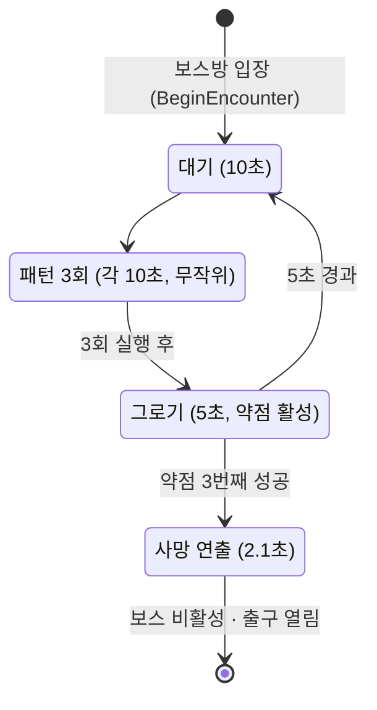

| 구간 | 0~10초 | 10~40초 | 40~45초 | 45~55초 | 55~85초 | 85~90초 | 90~130초 | 130~135초 |
|---|---|---|---|---|---|---|---|---|
| 보스 | 대기 | 패턴 ×3 | **그로기 ①** | 대기 | 패턴 ×3 | **그로기 ②** | 대기 · 패턴 ×3 | **그로기 ③** |

한 주기는 45초(대기 10 + 패턴 30 + 그로기 5)입니다. 약점은 밟는 즉시 꺼져 그로기 한 번에 한 번만 맞힐 수 있으므로, **가장 빠른 격파는 세 번째 그로기가 시작되는 약 130초(2:10)** 입니다. 보스 타이머 UI는 입장부터 격파까지를 잽니다.

| 패턴 | 공격 | 피해 | 실행 시간 | 애니메이션 |
|---|---|---|---|---|
| Eruption (운석) | 보스 위 10유닛, 좌우 ±8 범위의 무작위 위치에서 운석이 떨어진다(중력 2배). 15개를 1초 간격으로 만들지만 10초 뒤 다음 패턴이 끊어 실제로는 약 10개 | 10 | 10초 (잘림) | `Atk1` |
| Rampage (난사) | 보스 중심에서 8방향 동시 발사를 1.5초 간격으로 5번 (40발), 속도 10 | 6 | 6초 | `Atk2` |
| Razer (레이저) | 플레이어 방향 ±15° 안의 무작위 각도로 6~12발, 0.7초 간격, 속도 9. 현재는 판정 박스가 너무 커서 쏘자마자 지형에 닿아 사라진다 ([7.3 ①](#73-아쉬운-점과-향후-계획)) | 8 | 3.5~7.7초 | `Atk3` |

- 공통: 투사체마다 흰/검 무작위 · 같은 색이면 피격 · 회색 지형에 닿으면 소멸 · 10초 뒤 자동 소멸 · 패턴이 끝나면 남은 것 일괄 제거.
- 수치는 `Agis` 프리팹 값에 STAGE BOSS 씬의 오버라이드(운석 개수·간격, 난사 횟수, 레이저 개수·간격·속도)를 반영한 실제 값입니다.

| 운석 | 난사 | 레이저 |
|---|---|---|
| 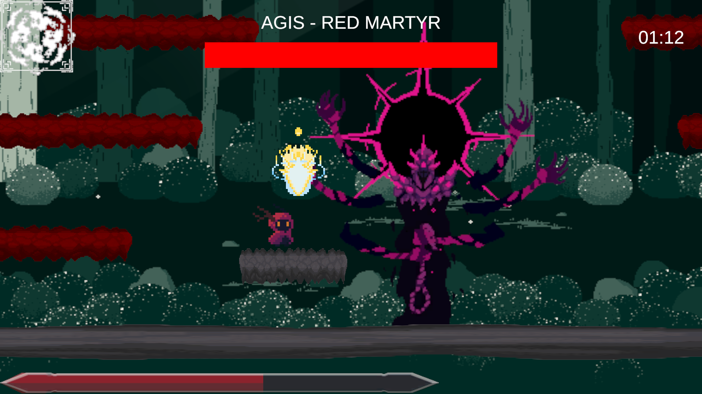 | 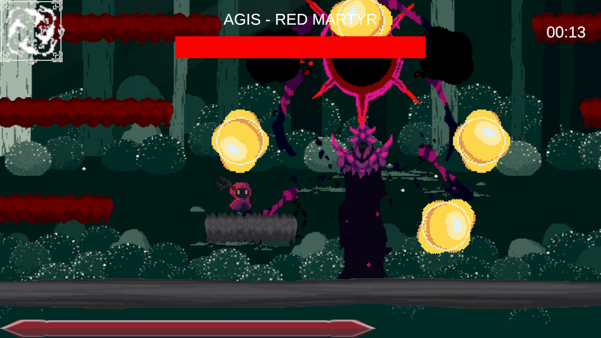 | 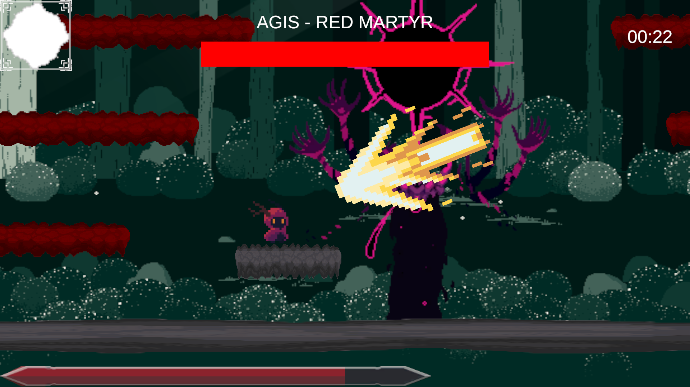 |

*패턴 3종(오른쪽 위 타이머는 보스방 입장부터 잰 실제 진행 시간). 탄마다 흰색 또는 검은색이 섞여 날아오므로, 한 색으로 버티는 대신 다가오는 탄과 **다른 색**이 되도록 Shift 시점을 골라야 합니다. 흰 탄은 스프라이트 원색 때문에 노란빛으로 보입니다. **운석**: 흰 운석이 흰색 플레이어 머리 위로 떨어지는 장면입니다. **난사**: 8방향 펄스가 퍼지는 장면입니다. **레이저**: 쏘자마자 사라지는 버그([7.3](#73-아쉬운-점과-향후-계획)) 때문에 발사 직후 프레임을 골랐습니다.*

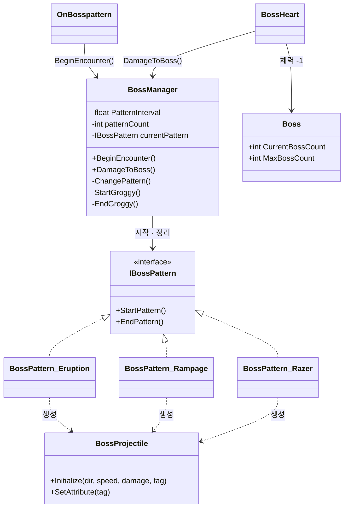

| 클래스 | 갖는 것 | 하는 일 | 하지 않는 일 |
|---|---|---|---|
| `BossManager` | 패턴 타이머, 실행 횟수, 지금 패턴 | 10초마다 이전 패턴 정리 → 무작위 패턴 시작, 3회 뒤 그로기, 사망 연출 | 패턴 내용, 투사체 |
| 패턴 3종 (`IBossPattern`) | 자기가 만든 투사체 목록 | 코루틴으로 공격, `EndPattern`에서 코루틴 중지와 투사체 제거 | 다음 패턴 고르기 |
| `BossProjectile` | 방향·속도·피해·속성 | 이동, 10초 수명, 같은 색 피격, 회색 지형에 소멸 | |
| `BossHeart` | | 위에서 밟히면 보스 체력 −1, 자신은 꺼짐 | 그로기 시간 |
| `Boss` | 남은 체력(3) | | |

### 5.2 사용법

**보스전 시작.** 보스방 입구의 트리거(`OnBosspattern`)가 보스 이름·체력·타이머 UI를 켜고 입구 문을 닫은 뒤 `BossManager.BeginEncounter()`를 부릅니다. 두 번 불려도 한 번만 시작합니다.

**새 패턴 추가하기.**

1. `IBossPattern`을 구현한 컴포넌트를 보스 오브젝트에 붙인다.
2. `StartPattern`에서 코루틴을 시작하고, 만든 투사체는 목록에 담는다.
3. `EndPattern`에서 `StopAllCoroutines()` 후 목록의 투사체를 파괴한다.
4. `BossManager`에 필드, `switch` 분기, 애니메이션 트리거를 추가한다. (4는 현재 구조의 한계 → [7.3](#73-아쉬운-점과-향후-계획))

```csharp
// IBossPattern.cs — BossManager가 패턴에 대해 아는 것은 '시작'과 '정리'뿐
public interface IBossPattern
{
    void StartPattern();
    void EndPattern();
}

// BossPattern_Rampage.cs (발췌) — 만든 투사체를 목록에 담아 두고, 끝날 때 남은 것을 모두 지운다
public void StartPattern()
{
    activeProjectiles.Clear();
    StartCoroutine(RampageRoutine());
}

public void EndPattern()
{
    StopAllCoroutines();                                   // 아직 쏘지 않은 펄스도 취소
    foreach (var projectile in activeProjectiles)
    {
        if (projectile != null) Destroy(projectile);       // 이미 맞아서 사라진 탄은 null
    }
    activeProjectiles.Clear();
}
```

| 바꾸고 싶은 것 | 고칠 곳 |
|---|---|
| 패턴 간격 | `Agis` 프리팹의 `BossManager.PatternInterval` (10초) |
| 패턴별 개수·간격·속도·피해 | `Agis` 프리팹의 패턴 컴포넌트 (STAGE BOSS 씬에서 일부 오버라이드) |
| 보스 체력(약점 성공 횟수) | `Boss.MaxBossCount` (3) |
| 그로기 시간 · 약점 성공 시 회복량 | `BossManager` 코드 상수 (5초 · HP +30) |

### 5.3 핵심 동작

**① 패턴 교체와 그로기**

```csharp
// BossManager.cs (발췌)
private void Update()
{
    if (!encounterStarted) return;
    if (!isGroggy) PatternManager();                       // 그로기 중에는 패턴 타이머도 멈춘다
}

private void ChangePattern()
{
    if (currentPattern != null) currentPattern.EndPattern();   // (1) 이전 패턴은 스스로 정리

    patternCount++;
    if (patternCount > 3)                                  // (2) 3회 뒤 그로기
    {
        StartGroggy();
        return;
    }

    switch (Random.Range(0, 3))
    {
        case 0: StartEruptionPattern(); break;            // 각 함수: 애니메이션 트리거 + currentPattern 지정 + StartPattern()
        case 1: StartRazerPattern(); break;
        case 2: StartRampagePattern(); break;
    }
}

private void StartGroggy()
{
    if (isGroggy) return;
    isGroggy = true;
    patternCount = 0;
    if (currentPattern != null)
    {
        currentPattern.EndPattern();
        currentPattern = null;
    }
    ForceIdleAnimation();                                  // (3) 남은 공격 트리거를 지우고 바로 Idle로
    bossHeart.gameObject.SetActive(true);                  // 약점 열기
    Invoke(nameof(EndGroggy), 5f);                         // 5초 뒤 자동 해제
}

private void ForceIdleAnimation()
{
    bossAnimator.ResetTrigger(ANIM_ATK1_ERUPTION);
    bossAnimator.ResetTrigger(ANIM_ATK2_RAMPAGE);
    bossAnimator.ResetTrigger(ANIM_ATK3_RAZER);
    bossAnimator.Play(ANIM_IDLE_STATE);
}
```

1. **정리는 패턴 스스로.** `BossManager`는 무엇이 남았는지 모르고 `EndPattern()`만 부릅니다. 운석이 15개 중 10개째를 만들던 중이어도 코루틴과 남은 운석이 함께 사라집니다.
2. **3회 뒤 그로기.** 그로기 중에는 `Update`가 `PatternManager`를 부르지 않아 타이머가 0에 멈춰 있다가, 그로기가 끝나면 다시 10초를 셉니다. 5.1의 '대기 10초'가 이렇게 생깁니다.
3. **트리거는 소비될 때까지 남는다.** 그로기 직전에 걸린 공격 트리거가 남아 있으면 Idle로 돌아오자마자 공격 모션이 재생됩니다. 공격 트리거 3개를 모두 지우고, 전환 조건(Exit Time)을 기다리지 않고 Idle 상태를 바로 재생합니다.

**② 약점과 사망**

```csharp
// BossHeart.cs — 그로기 때만 켜지는 약점. 플레이어가 위에서 내려와 닿았을 때만 인정한다
private void OnTriggerEnter2D(Collider2D collision)
{
    if (collision.gameObject.name != "Shifter") return;
    if (collision.transform.position.y <= transform.position.y) return;   // 옆·아래에서 닿으면 무시

    boss.CurrentBossCount--;
    bossManager.DamageToBoss();                            // 플레이어 HP +30, 체력이 0이면 사망 연출
    gameObject.SetActive(false);                           // 그로기 한 번에 한 번만
}

// BossManager.cs — 사망: 예약된 그로기 해제를 취소하고, 패턴·약점을 정리한 뒤 애니메이션 길이만큼 기다린다
private IEnumerator PlayDeathAndDisappear()
{
    CancelInvoke(nameof(EndGroggy));
    isGroggy = false;
    encounterStarted = false;
    if (currentPattern != null)
    {
        currentPattern.EndPattern();
        currentPattern = null;
    }
    bossHeart.gameObject.SetActive(false);
    bossAnimator.SetTrigger(ANIM_DEATH);
    yield return new WaitForSeconds(deathAnimationDuration);   // boss_death 클립 길이 (2.1초)
    gameObject.SetActive(false);
}
```

- 약점은 속성과 무관합니다. 흰색이든 검은색이든 위에서 밟으면 성공입니다.
- 사망과 동시에 출구 문(`boss outdoor`)이 열리고, 타이머는 보스 체력이 0이 된 순간에 멈춥니다.

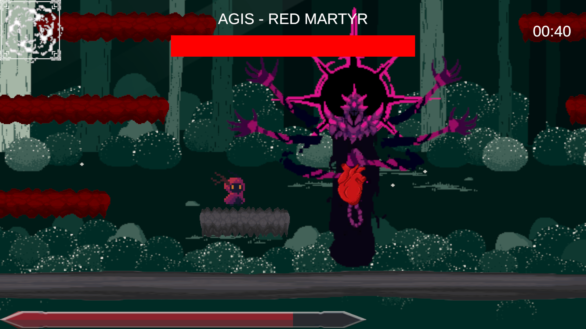

*첫 번째 그로기(입장 후 00:40). 패턴 3회가 끝나면 보스 가슴에 약점이 5초 동안 나타나고, 위에서 밟으면 보스 체력 바가 한 칸 줄고 플레이어 HP가 30 회복됩니다.*

**예외 상황 처리**

| 상황 | 처리 |
|---|---|
| 입구 트리거를 다시 지나감 | `BeginEncounter`가 이미 시작됐으면 무시 |
| 패턴 도중 다음 패턴 · 그로기 · 사망 | `EndPattern`이 코루틴을 멈추고 남은 투사체를 파괴 |
| 투사체가 이미 맞아서 사라짐 | 목록의 null은 건너뜀 |
| 아무것도 맞히지 못한 투사체 | 10초 뒤 스스로 파괴 |
| 약점을 옆이나 아래에서 건드림 | 무시 (y 좌표 비교) |
| 그로기 중 사망 | 예약된 `EndGroggy`를 `CancelInvoke`로 취소 |

### 5.4 고민과 선택

**결정 1. 패턴의 공통 구조: 추상 클래스 vs 인터페이스**

> **[대안 A] 추상 클래스 `BossPattern : MonoBehaviour`**
> - 장점: 공통 코드(투사체 목록, 정리 반복문)를 부모에 한 번만 둔다.
> - 단점: 세 패턴의 공통점은 '시작과 정리'뿐이고 공격 방식(낙하, 원형 발사, 조준 발사)은 모두 다르다. 부모가 가질 동작이 거의 없다.
>
> **[대안 B] 인터페이스 `IBossPattern`**
> - 장점: `BossManager`는 `StartPattern`/`EndPattern` 두 함수만 알면 된다. 패턴은 공격 방식을 자유롭게 구현한다.
> - 단점: '투사체를 목록에 담고 `EndPattern`에서 지우기'가 세 패턴에 똑같이 반복된다.
>
> **[결정] 대안 B.** 처음에는 빈 `BossPattern` 클래스로 시작했다가(07.01) 지우고, 패턴을 실제로 구현할 때(07.06) 인터페이스로 정했습니다. 패턴끼리 공유하는 것은 동작이 아니라 **약속(시작하면 끝낼 수 있어야 한다)** 이라고 봤기 때문입니다. 대가인 정리 코드 반복은 3곳 × 8줄 정도라 감수했습니다. 다만 `BossManager`가 아직 패턴의 구체 타입을 `switch`로 알고 있어, 인터페이스의 장점을 절반만 쓰고 있습니다([7.3](#73-아쉬운-점과-향후-계획)).

**결정 2. 보스전 랜덤 발판을 유지할까, 걷어낼까?**

> **배경.** 07.06에 '패턴마다 보스 주변(반경 2~6) 무작위 위치에 흰/검 무작위 발판 5개를 생성'하는 기능을 넣었습니다. 보스전에서도 Shift로 발판을 골라 밟게 하려는 것이었습니다.
>
> **[대안 A] 유지하고 생성 위치를 검사한다**
> - 장점: 보스전에도 발판 Shift 요소가 남는다.
> - 단점: 좁은 보스방에서 '서로 겹치지 않고, 플레이어와 겹치지 않고, 닿을 수 있는' 위치를 찾는 규칙과, 위치를 못 찾았을 때의 처리가 필요하다.
>
> **[대안 B] 기능을 걷어내고 고정 지형에서 싸운다**
> - 장점: 플레이어가 갇히는 상황이 원천적으로 사라진다. `PlatformManager`가 런타임 발판을 신경 쓸 이유도 사라진다.
> - 단점: 보스전의 발판 Shift 요소가 줄고, 탄환 회피 중심이 된다.
>
> **[결정] 대안 B (07.10).** 발판이 좁은 영역에 겹쳐 생기거나, **흰·검 발판이 둘 다 플레이어 위치에 생기면 빠져나갈 방법이 없었습니다.** 플레이어의 BoxCast는 이미 겹쳐 있는 콜라이더를 거리 0으로 맞히므로 그 자리에서 움직일 수 없고, 어느 색으로 Shift해도 둘 중 하나는 켜져 있습니다. 플레이어가 실력으로 대응할 수 없는 실패가 무작위로 생기는 것은 공정하지 않다고 판단해, 위치 검사 규칙을 만드는 대신 기능을 걷어냈습니다.

| | As-Is (07.06 ~ 07.09) | To-Be (07.10 ~) |
|---|---|---|
| 보스방 발판 | 패턴이 바뀔 때마다 보스 반경 2~6 안 무작위 위치에 흰/검 무작위 발판 5개 (동시에 최대 5개) | 고정 지형만 (검 발판 1 · 레드 타일 6 · 회색 지형) |
| 플레이어가 갇힐 가능성 | 생성 위치를 검사하지 않아, 흰·검 발판이 플레이어 위치에 함께 생기면 빠져나올 수 없음 | 플레이 중 생기는 발판이 없어 구조적으로 발생하지 않음 |
| 코드 | `BossManager`에 생성·제거 함수 2개와 필드 4개 | `BossManager` 67줄 삭제 · 8줄 추가, `PlatformManager` 5줄 삭제 (`27df7eb`) |

---

## 6. 기타 구현

| 기능 | 구현 요점 | 클래스 |
|---|---|---|
| 키네마틱 이동 | 공용 `CharacterController2D` 사용. 물리 프레임마다 가로·세로를 따로 BoxCast해 막힌 거리까지만 이동(skinWidth 0.01), 세로가 막히면 낙하 속도 0. 땅에 닿으면 점프 횟수 초기화(2단 점프). 수치: 속도 8, 중력 −24, 점프력 11 | `CharacterController2D` |
| 박스 밀기 (추가 구현) | 가로 BoxCast에 맞은 대상이 Dynamic `Rigidbody2D`면 그 속도를 플레이어 속도로 덮어써 민다 (아래 6.2) | `CharacterController2D`, 박스 |
| 좌우 반전 | 루트의 `transform.localScale.x`를 ±1로 뒤집어 그림과 콜라이더가 함께 반전된다 ([7.2 ①](#72-문제-해결-경험)) | `ShifterController` |
| 카메라 | 비대칭 데드존(좌우 ±4, 위 5, 아래 1) 밖으로 나갈 때만 목표를 옮기고, 카메라는 목표를 Lerp로 따라간다 (아래 6.1) | `CameraController` |
| 피해와 HP | 피해는 `ITakeDamage` 하나로 받는다. HP 프로퍼티가 0~100으로 자르고 HP 바를 갱신, 0이면 게임오버 화면과 `timeScale` 0. 피격 시 0.1초 간격으로 빨간색 3번 점멸 | `Shifter`, `ITakeDamage` |
| 레드 타일 | 부모 하나가 자식 타일 콜라이더 전체를 `IsTouching`으로 검사한다. 닿아 있는 동안 타이머를 쌓아 간격마다 피해, 떨어지면 타이머 초기화 | `Red` |
| 총알 발사기 | `firePivot` → `endPivot` 방향으로 일정 간격 발사. 사거리 = 두 점 사이 거리라 레벨에서 끝점만 옮기면 된다 | `BulletLauncher`, `Bullet` |
| 이동 발판 | `Mathf.PingPong`으로 시작 위치 기준 ±거리 왕복 | `MovingPlatform` |
| 일시정지 | Esc로 `timeScale` 0/1과 일시정지 화면을 토글 | `ShifterController` |
| 씬 전환 | UI 버튼이 문자열 인자(`Exit` / `Restart` / `Menu` / 씬 이름)로 `ChangeSceneByName`을 부른다. 포탈은 W·↑로 다음 빌드 인덱스 | `SceneChanger`, `Portal` |
| 보스 UI | 입장 트리거가 보스 이름·체력·타이머 UI를 켠다. 체력 바 = 남은 체력 / 3, 타이머 = 입장부터 격파까지(mm:ss) | `OnBosspattern`, `BossHealthUI`, `BossTimerUI` |

### 6.1 카메라: 위는 넓게, 아래는 좁게

```csharp
// CameraController.cs (발췌) — 데드존 밖으로 나간 만큼만 목표를 옮기고, 카메라는 목표를 부드럽게 따라간다
void LateUpdate()
{
    if (player == null) return;

    float deltaX = player.position.x - targetX;
    if (Mathf.Abs(deltaX) > horizontalDeadZone)
        targetX += deltaX - (Mathf.Sign(deltaX) * horizontalDeadZone);

    float deltaY = player.position.y - targetY;
    if (deltaY > 0.0f)
    {
        if (deltaY > deadZoneUp) targetY += deltaY - deadZoneUp;                      // 위: 넓게 (5)
    }
    else
    {
        if (Mathf.Abs(deltaY) > deadZoneDown) targetY += deltaY + deadZoneDown;        // 아래: 좁게 (1)
    }

    Vector3 targetPosition = new Vector3(targetX, targetY, 0f) + offset;
    transform.position = Vector3.Lerp(transform.position, targetPosition, smoothing * Time.deltaTime);
}
```

- 점프 한 번의 높이는 약 2.5유닛(점프력 11, 중력 −24), 2단 점프도 약 5유닛이라 **제자리 점프로는 카메라가 거의 움직이지 않습니다.** 반대로 떨어질 때는 1유닛만 벗어나도 따라 내려가 착지할 곳을 먼저 보여 줍니다.
- 보스방은 위쪽 데드존을 3.5로 줄여, 2단 점프를 하면 카메라가 따라 올라갑니다.
- `OnDrawGizmos`로 데드존 상자를 Scene 뷰에 그려, 값을 화면에서 보며 맞췄습니다.

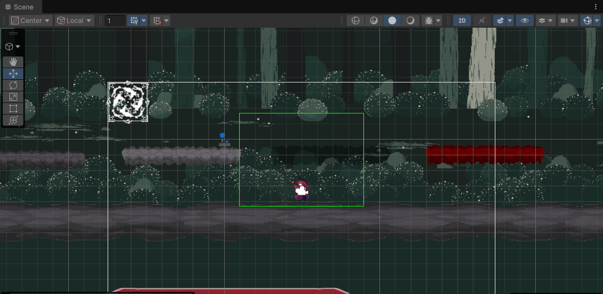

*Scene 뷰에 그린 데드존(초록 상자). 위쪽이 넓고 아래쪽이 좁은 비대칭 상자이며, 플레이어가 이 상자를 벗어날 때만 카메라 목표가 움직입니다.*

### 6.2 박스 밀기: 공용 유틸리티에 추가한 부분

```csharp
// CharacterController2D.cs (발췌) — 가로 이동이 Dynamic 물체에 막히면, 그 물체에 플레이어 속도를 준다
RaycastHit2D hit = Physics2D.BoxCast(box.center, box.size, 0.0f, dir, distance, collisionLayer);
if (hit.collider == null) return move;

if (axis == Vector3.right)                                          // 추가한 부분
{
    Rigidbody2D pushBody = hit.collider.GetComponent<Rigidbody2D>();
    if (pushBody != null && pushBody.bodyType == RigidbodyType2D.Dynamic)
    {
        pushBody.linearVelocity = new Vector2(dir.x * speed, pushBody.linearVelocity.y);
    }
}

float allowed = Mathf.Max(0, hit.distance - skinWidth);
return Mathf.Sign(move) * allowed;
```

플레이어는 이번 프레임에 박스 앞에서 멈추고, 박스는 받은 속도로 물리 엔진이 옮깁니다. 다음 프레임에는 앞이 비어 플레이어가 따라 들어가므로 '밀고 가는' 움직임이 됩니다. 박스에는 마찰이 있는 Physics Material을 줘서, 밀기를 멈추면 미끄러지지 않고 섭니다. 세로 속도는 그대로 두어 박스는 밀리는 중에도 중력으로 떨어집니다.

---

## 7. 결과 및 배운 점

### 7.1 결과

| 개요의 목표 | 결과 | 근거 |
|---|---|---|
| 메뉴부터 보스 격파까지 한 판 | 메뉴 → STAGE 1 → STAGE 2 → 보스 → 메뉴, 게임오버 · 재시작 · 일시정지까지 구현 | 씬 4개, '게임 제작 완료' 커밋(07.07) |
| 모든 기믹을 Shift 규칙 하나로 | 발판·탄환·크러셔 벽·속성 UI의 판정이 모두 '플레이어 태그와 같은가' 비교 하나. 레이저 퍼즐은 콜라이더 끄기 덕분에 추가 코드 없이 Shift 규칙을 따름. 다만 STAGE 1 총알과 STAGE 2 레드 타일은 충돌 설정(트리거) 문제로 판정이 불리지 않는 것을 테스트로 확인함 | 아래 표, 7.3 ① |
| 패턴이 바뀌어도 깨끗한 보스전 | 패턴 3종이 `EndPattern`에서 코루틴과 투사체를 정리. 패턴 전환 · 그로기 · 사망 어느 경로에서도 이전 패턴의 탄이 남지 않음 | 테스트 3회 모두 패턴 전환 직후 남은 투사체 0개 |
| 스테이지 기믹 | 레드 타일, 총알 발사기, 박스, 전구, 이동 발판, 레이저 반사, 크러셔 벽 (7종) | 4.1 |

**Shift 규칙 하나로: 규칙을 쓰는 쪽의 코드량**

| 항목 | 코드량 | 근거 |
|---|---|---|
| 플레이어 속성을 바꾸는 코드 | `Shifter.ShiftTag()` 한 곳 (3.3 ①의 세 줄) | 3.3 ① |
| 흰·검 발판 추가 | 코드 수정 0줄. STAGE 2의 발판 20개(흰 9 · 검 11)를 모두 프리팹 배치만으로 넣음 | 3.2, `PlatformManager`가 태그로 수집 |
| 레이저 퍼즐이 Shift 규칙을 따르는 데 든 코드 | 0줄. `LightBeam.cs`(144줄)에 태그·속성을 다루는 코드가 없음 (`CompareTag`·`.tag` 검색 결과 0건) | 3.4 결정 3, 4.3 ① |
| 보스 투사체에 색 입히기 | 패턴마다 `BossAttributeUtil.RandShiftTag()`로 색을 고르는 1줄. 태그와 색을 함께 입히는 곳은 `BossAttributeUtil.Apply` 한 곳 | 3.2 |

**테스트 플레이 (2026.11.09, 에디터 자동 테스트 3회)**

Unity 에디터 플레이 모드에서 임시 테스트 스크립트로 세 스테이지를 3회씩 돌렸습니다. 플레이어 입력은 Input System 이벤트(실제 Shift·Esc·D 키)로 넣었고, 위치 이동과 판정 확인은 스크립트로 했습니다. 테스트가 끝난 뒤 스크립트는 지웠습니다.

| 확인한 것 | 결과 | 판정 |
|---|---|---|
| 빌드용 스크립트 컴파일 (7.2 ③ 수정 후) | `Assembly-CSharp.dll` 생성, 오류 0 | 통과 |
| 실제 Shift 키 입력 | 회색 → 흰색 → 검은색 전환, 쿨타임 1초 | 통과 |
| 회색(Common) 상태의 보스 탄 면역 | 난사 패턴 7초, 피해 0 | 통과 (의도) |
| STAGE 1 레드 타일 (트리거) | 3초 동안 6회 피격, 피해 30. 발판 역할도 유지 | 통과 |
| 다른 색 발판 안에서 Shift | 0.6초 동안 이동 0 (갇힘). 다시 Shift하면 풀림 | 7.3 ① 재현됨 |
| 박스 밀기 | 1.6초에 약 11.4유닛 밀림 | 통과 |
| 전구 퍼즐 | 1번 → `GGWWW`, 2번 → `WWGWW`, 리셋 → `WWWWW`. 정답 {2, 5}로 5개 모두 초록, 문 2 열림 | 통과 |
| 일시정지 / 게임오버 | Esc로 `timeScale` 0 ↔ 1. HP 0이면 게임오버 화면, `timeScale` 0 | 통과 |
| 게임오버 중 Esc 두 번 | `timeScale` 1로 돌아오고, HP 0인 채 D 키로 4.8유닛 이동 | 7.3 ② 재현됨 |
| **STAGE 1 총알 피격** | 레드 타일이 없는 지점에서 총알 8발이 플레이어를 지나갔지만 피해 0, 맞고 사라진 총알 0 (흰색·회색 모두) | **버그** (7.3 ①) |
| **STAGE 2 레드 타일** | 3초 동안 피해 0, `IsTouching` 거짓 (`isTrigger` 꺼짐) | **버그** (7.3 ①) |
| 레이저 퍼즐 | 검은색: 거울 3번 반사(59.25°)로 해결. 흰색: 검은 발판이 꺼져 거울 없이 **오른쪽 직선 한 번**에 해결 | 확인 필요 (7.3 ①) |
| 크러셔 벽 | 같은 색 벽 2개는 통과(이동 0), 다른 색 벽 1개는 플레이어를 약 60유닛 끌고 감. 바닥 레드 타일의 피해 0 | 동작 확인 |
| 보스 패턴 주기 (자연 진행) | 9.9초 첫 패턴 → 19.9초 → 29.9초 → **39.9초 그로기** | 5.1과 일치 |
| 패턴 정리 | 패턴 전환 직후 남은 투사체 0 (3회 모두) | 통과 |
| 약점 | 옆·아래에서 닿으면 무시. 위에서 밟으면 보스 체력 −1, HP 50 → 80. 3회째에 보스 비활성 · 출구 열림 · 타이머 정지 | 통과 |
| **보스 레이저 패턴** | 레이저 7발의 수명 0.04~0.2초, 이동 거리 약 1.6유닛. 플레이어에게 닿은 적 없음 (피해 0) | **버그** (7.3 ①) |

### 7.2 문제 해결 경험

**① 왼쪽을 보면 충돌 범위가 그림과 어긋나던 문제 (07.01)**

- **(문제)** 왼쪽으로 이동하면 캐릭터 그림은 뒤집히는데 충돌 범위는 오른쪽을 볼 때 그대로 남아, 벽·발판과 닿는 위치가 그림과 달랐습니다.
- **(원인)** 좌우 반전을 Animator가 붙은 **자식** 오브젝트의 스케일로 했습니다. 콜라이더는 루트(`Shifter`)에 있어 뒤집히지 않았고, 이 콜라이더는 중심에서 x로 약 0.27 치우쳐 있어(offset 0.265) 차이가 그대로 드러났습니다.
- **(해결)** 루트의 `transform.localScale.x`를 뒤집어 그림과 콜라이더가 함께 반전되게 했습니다.

```csharp
// ShifterController.cs — 07.01 수정
// 전: animator.transform.localScale = new Vector3(FacingDirection, 1, 1);   // 그림(자식)만 뒤집힘
transform.localScale = new Vector3(FacingDirection, 1, 1);                    // 루트째 뒤집어 콜라이더도 함께
```

**② 겹치면 얼어붙는 문제: 크러셔 벽과 보스전 랜덤 발판 (07.07, 07.10)**

- **(문제)** 두 곳에서 같은 증상이 나왔습니다. 크러셔 벽에 콜라이더를 켜 두면 벽이 플레이어와 겹치는 순간 플레이어가 얼어붙었고, 보스전 랜덤 발판이 플레이어 위치에 생기면 빠져나올 수 없었습니다.
- **(원인)** 플레이어는 이동할 때마다 '지금 위치에서 이동 방향으로' BoxCast를 쏩니다. 프로젝트 설정상 레이캐스트는 이미 들어가 있는 콜라이더도 맞히므로(`Queries Start In Colliders`), 겹친 상태에서는 모든 방향이 거리 0으로 막힙니다. 키네마틱 이동에는 겹침을 풀어 주는 처리가 없습니다. 랜덤 발판은 흰·검이 둘 다 겹치면 어느 색으로 바꿔도 하나는 켜져 있어 Shift로도 풀 수 없었습니다.
- **(해결)** 크러셔 벽은 콜라이더를 끄고 겹침을 직접 검사해 벽 이동량만큼 플레이어를 옮겼습니다([4.4 결정 1](#44-고민과-선택)). 랜덤 발판은 생성 위치 검사 규칙을 만드는 대신 기능을 걷어냈습니다([5.4 결정 2](#54-고민과-선택)). 두 문제의 공통 원인인 '겹침 해소 없음'은 [7.3](#73-아쉬운-점과-향후-계획)에 남은 과제로 적었습니다.

**③ 고쳤던 빌드 에러가 리팩토링에서 되살아난 문제 (07.07 → 07.10 → 11.09)**

- **(문제)** 메뉴의 종료 버튼 코드에 에디터 전용 API(`UnityEditor.EditorApplication.isPlaying`)가 있어, 빌드하면 `UnityEditor` 네임스페이스를 찾지 못해 컴파일 에러가 납니다.
- **(원인)** 07.07 검수에서 `#if UNITY_EDITOR`로 감싸 고쳤고 검수 기록(`CLEANUP_LOG.md`)에도 남겼지만, 07.10 리팩토링 커밋에서 이 두 줄이 다시 빠졌습니다. 에디터 플레이에서는 `UnityEditor`가 있어 정상 동작하므로 드러나지 않았습니다.
- **(해결)** 기술 문서를 쓰며 커밋 이력을 다시 읽다가 발견해 다시 감싸고 커밋했습니다(11.09, `4f8786b`). 런타임 스크립트 중 `UnityEditor`를 참조하는 곳은 이 한 곳뿐임을 검색으로 확인했습니다.

```csharp
// SceneChanger.cs — 빌드에는 UnityEditor가 없으므로, 에디터에서만 컴파일되게 감싼다
if (sceneName == "Exit")
{
    Application.Quit();
#if UNITY_EDITOR
    UnityEditor.EditorApplication.isPlaying = false;   // 에디터에서는 Play 모드 종료
#endif
}
```

### 7.3 아쉬운 점과 향후 계획

아쉬운 점은 두 갈래입니다. ①은 11.09 테스트 플레이에서 찾았지만 아직 고치지 않은 문제로, 고치면 7.2(문제 해결 경험)로 옮길 항목입니다. ②는 구조에서 나온 부채로, 기능을 늘릴수록 고치는 비용이 커지는 항목입니다. 게임 상태 분산처럼 증상(게임오버 중 Esc)이 이미 드러난 것도 있습니다.

**① 테스트로 찾은 미수정 문제**

| 문제 | 원인 | 고칠 방법 (To-Be) |
|---|---|---|
| **STAGE 1 총알이 맞지 않는다** | 플레이어는 키네마틱 `Rigidbody2D`인데, `Bullet` 프리팹은 `Rigidbody2D`도 없고 콜라이더가 트리거도 아니다. 2D 물리에서 키네마틱과 정적 콜라이더 사이에는 (트리거가 아니면) 접촉이 생기지 않아 `OnTriggerEnter2D`가 불리지 않는다 | 총알 콜라이더를 트리거로 바꾼다. 투사체를 하나로 합칠 때(아래) 보스 탄처럼 트리거 + Rigidbody로 통일한다 |
| **STAGE 2 레드 타일에 화상이 없다** | STAGE 1·보스방은 씬에서 레드 타일의 `isTrigger`를 켜 두었는데 STAGE 2의 3개만 꺼져 있다. 같은 이유로 접촉이 생기지 않아 `IsTouching`이 항상 거짓이다. 크러셔 벽 구간 바닥이 이 레드 타일이라, 벽에 끌려가도 피해가 없다 | 레드 타일 프리팹 자체를 트리거로 바꿔 씬마다 오버라이드하지 않게 한다. 트리거여도 플레이어 이동의 BoxCast가 트리거를 맞히므로(`Queries Hit Triggers`) 발판 역할은 유지된다 |
| **보스 레이저가 쏘자마자 사라진다** | 레이저 프리팹의 트리거가 6×4유닛(박스 2×2에 스케일 3×2)으로 커서, 플레이어 쪽으로 기울어 날아가자마자 회색 발판·지형에 닿아 0.2초 안에 파괴된다. 테스트 3회 내내 레이저 피해가 0이었다 | 판정 박스를 눈에 보이는 레이저 크기로 줄이고, 회색 지형에서 사라지는 규칙이 보스 몸 근처에서 바로 적용되지 않도록 발사 위치를 보스 바깥으로 옮긴다 |
| **Shift 순간 다른 색 발판 안에 갇힌다** | Shift 순간에 겹침을 검사하지 않는다. 다른 색 발판을 지나는 도중 Shift하면 그 발판이 켜지며 플레이어가 그 안에 갇히고, 다시 Shift할 수 있는 1초 뒤까지 움직이지 못한다 (7.2 ②와 같은 원인) | Shift 전에 `Physics2D.OverlapBox`로 새 색 발판과 겹치는지 확인해 막거나, 겹치면 가장 가까운 바깥으로 밀어낸다 |
| **레이저 퍼즐이 흰색 상태에서는 직선 한 번으로 풀린다** (의도 확인 필요) | 검은색에서는 거울 3번 반사(59.25°)가 필요하지만, 흰색이 되면 길을 막던 검은 발판이 꺼져 센서까지 직선이 열린다. 콜라이더를 끄는 방식이 레이저에 그대로 적용된 결과다([3.4 결정 3](#34-고민과-선택)). 의도한 지름길이 아니라면 거울을 쓸 이유가 사라진다 | 의도가 아니라면 직선 경로를 회색 지형으로 막고, Shift는 '거울 사이의 발판'에만 영향을 주도록 배치를 조정한다 |

**② 구조의 기술 부채**

| 아쉬운 점 | 왜 문제인가 | 향후 계획 (To-Be) |
|---|---|---|
| `PlatformManager`가 매 프레임 태그로 발판을 다시 찾고, `Rigidbody2D` 유무로 관리 대상을 거른다 | 이유였던 보스전 랜덤 발판은 사라졌는데, 판정이 바뀌는 순간(Shift)과 무관하게 매 프레임 배열 4개 할당과 `GetComponent`가 반복된다. 크러셔 벽처럼 관리에서 빼려면 `Rigidbody2D`를 붙여야 하는 암묵 규칙도 남았다. 거꾸로 `Rigidbody2D`가 없는 STAGE 1 총알은 흰·검 태그 때문에 '발판'으로 관리되어, 반대 색 총알이 반투명해지는 의도하지 않은 효과도 생긴다 | 시작할 때 한 번 모으고(관리할 발판은 컴포넌트로 명시), `Shifter`가 속성을 바꿀 때 이벤트를 내면 그때만 갱신한다. `UIModManager`가 이미 '바뀔 때만 갱신'으로 동작한다 |
| 속성이 태그를 차지해, 플레이어를 이름 문자열 `"Shifter"`로 판별한다 (6개 파일 7곳) | 오브젝트 이름을 바꾸면 7곳이 조용히 깨진다. 플레이어 태그가 시작하자마자 `Common`으로 바뀌므로, `UIModManager`의 `FindWithTag("Player")` 대체 경로는 실행 순서에 따라 플레이어를 찾지 못한다 | 속성을 enum 컴포넌트로 옮기고 태그는 `Player`로 되돌린다. 플레이어 판별은 컴포넌트(`TryGetComponent<Shifter>`)나 Player 레이어로 |
| 투사체 코드가 두 벌이다 (`Bullet`: Transform 이동·사거리 소멸·`ITakeDamage` / `BossProjectile`: Rigidbody 이동·10초 소멸·`Shifter` 직접 호출) | 같은 규칙(같은 색이면 피격)을 두 곳에서 고쳐야 한다. `BulletLauncher`는 `BossAttributeUtil`을 쓰지 않고 태그와 색을 직접 지정한다 | 투사체 하나로 합치고(이동 방식만 옵션), 색 지정은 `BossAttributeUtil`, 피해는 `ITakeDamage`로 통일한다 |
| `BossManager`가 패턴의 구체 타입과 애니메이션 트리거를 `switch`로 직접 안다 | 패턴을 추가하면 `BossManager`를 고쳐야 한다. 인터페이스는 `EndPattern` 호출에만 쓰인다 | `IBossPattern`이 자기 애니메이션 트리거를 갖게 하고, `GetComponents<IBossPattern>()` 배열에서 무작위로 고른다 |
| 게임 상태가 한 곳에 없다. 일시정지는 `ShifterController`, 게임오버는 `Shifter`가 각자 `timeScale`을 바꾼다 | 게임오버 화면에서도 Esc가 먹는다. 일시정지를 켰다 끄면 `timeScale`이 1로 돌아와 게임오버 화면이 뜬 채 게임이 다시 흐른다 | 진행 · 일시정지 · 게임오버 상태를 한 곳에서 관리하고, 입력은 상태를 보고 처리한다 |
| 전구 퍼즐의 상태가 스프라이트 색이다 (`color == Color.green`) | 전구 색 연출을 바꾸면 판정이 깨진다. 문이 열릴 때까지 매 프레임 개수를 센다 | `bool[]` 상태를 두고 색은 표시만 한다. 판정은 버튼을 밟을 때 한 번 |
| 수치가 코드 기본값 · 프리팹 · 씬 오버라이드에 흩어져 있다 | 실제로 적용되는 값을 찾으려면 세 곳을 봐야 한다(예: Shift 쿨타임은 코드 2초 / 프리팹 1초). 운석 패턴(15개 × 1초)은 패턴 간격(10초)에 잘려 약 10개만 떨어지는 등, 서로 관련된 값이 따로 조정된다 | 조절값을 ScriptableObject 설정으로 모으고, 패턴 길이가 간격을 넘으면 경고하거나 패턴이 끝났다고 알린 뒤 다음으로 넘어간다 |

### 7.4 배운 점

- **규칙 하나가 시스템 전체를 설명하게 만든다.** "같은 색이면 실체" 규칙을 콜라이더 자체를 끄는 방식으로 구현하자, 나중에 만든 레이저 퍼즐이 추가 코드 없이 그 규칙을 따랐습니다. 대신 그 규칙의 부작용도 함께 퍼졌습니다. 태그는 오브젝트당 하나라 플레이어를 이름으로 찾게 됐고, 레이저에는 흰색 지름길이 생겼습니다. 규칙을 고를 때는 그것을 표현할 수단의 제약과 규칙이 닿는 범위까지 함께 봐야 합니다.
- **물리 엔진 밖으로 나왔으면 끝까지 책임진다.** 키네마틱 이동은 미끄러짐 없는 정확한 조작감을 줬지만, 밀기(박스) · 밀리기(크러셔 벽) · 겹침(랜덤 발판, Shift 순간)을 모두 직접 처리해야 했습니다. 플레이어를 옮기는 길을 `CharacterController2D` 하나로 모은 것이 이 비용을 줄였고, 아직 처리하지 못한 '겹침 해소'가 남은 과제입니다.
- **바꾼 이유가 사라지면 설계도 되돌리고, 리팩토링 뒤에는 빌드한다.** 매 프레임 검색은 런타임 발판 때문에 도입했는데, 발판을 지운 리팩토링에서 '왜 매 프레임 검색하는가' 주석만 지워지고 검색 코드는 남았습니다. 같은 커밋에서 고쳤던 빌드 에러도 되살아났습니다. 리팩토링은 기능을 빼는 일이기도 하므로, 뺀 기능에 기대던 코드와 빌드 결과를 함께 확인해야 합니다.
